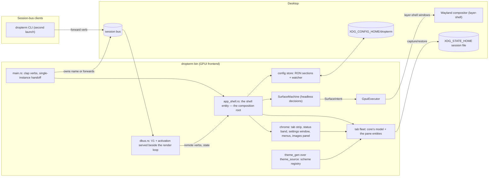
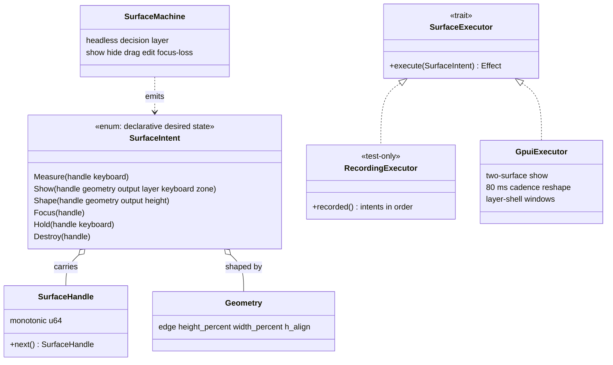

# Architecture

How the DropTerm codebase is laid out: one package with two halves, one module inventory, a handful of load-bearing seams, and where the reasoning behind each lives. Since the GPUI cutover there is one terminal binary — the libcosmic frontend it replaced is deleted, with its reasoning preserved in the [research records](research/README.md) and the [portability plan](research/portability-plan.md) that carried the rewrite — and the 2026-11-15 collapse (cu-4) dissolved the crate split into one package, the panel applet leaving the tree with it (its record lives in the [research archive](research/archive/v3-panel-applet.md)).

## One package, two halves

- **The bin** (`dropterm/src/main.rs` + the bin's modules) - the terminal itself, a GPUI program: the surface, the terminal pane, the chrome (tab strip, status band, the Settings window, menus), and the CLI. Built on the ruled `gpui-pre` pin through the [Kit](research/kit-root-border.md).
- **The lib** (`dropterm/src/lib.rs` + the `core` module) - the toolkit-neutral core: the config store, session, profiles, the engine, the pure models (spawn resolution, tabs, geometry, keybinds, status segments, context-menu rows), and `dbus_state`. No toolkit dependency, pinned by test; the bin consumes it by name.

## How it connects

One process, one bus name, one surface - and every external touch goes through a seam the diagrams below make visible. GitHub renders these diagrams; the raw markdown carries the same text.

## Module inventory

The recurring split is *pure model* vs *wiring*, and the shared-core split made it a crate boundary: the `core` rows are the toolkit-neutral half (model, math, decisions), the `bin` rows the GPUI wiring that needs a compositor or a window. Unit tests live inline in `#[cfg(test)]` sibling modules (`*/tests.rs` in either crate).

| Crate | Module | Role |
|---|---|---|
| bin | `main.rs` | CLI entry: the guard's ordering, the check-harness dispatch (`DROPTERM_CHECK`), the single-instance handoff; the CLI surface itself lives in `cli.rs` |
| bin | `cli.rs` | The clap verbs — surface and tab alike — the forward-word encoder, the first-launch degradation, and the reconstruction parse the dbus decode rides (one truth for launch, forward, and receive) |
| bin | `startup.rs` | The layer-shell guard: the registry probe on this binary's own wayland-client connection, core's verdict, the refuse-and-exit branch |
| bin | `app_shell.rs` | The shell entity: the tick (verb drain, session save, title/attention/status syncs), the spawn funnel, the tab-verb application, the close gate, the window composition — the composition root |
| bin | `dbus.rs` | The control bus beside the render loop: V1 + activation on a held zbus connection, the action decode, the served-state mirror (`Visible`, `TabCount`) |
| bin | `executor.rs` | The GPUI surface executor: translates each intent into the layer-shell window sequence (measure, two-surface show, the 80 ms cadence reshape) |
| bin | `terminal/view.rs` | The terminal pane: the render entity over the engine's grid (per-row shaping, damage discipline, the two-pass image paint), `boot_pane` and `PaneRequest` (the one spawn construction path) |
| bin | `terminal/` | The pane's halves: `input.rs` (key/mouse translation), `grid.rs` (the projection), `selection.rs`, `images.rs` (the render-image cache), `clipboard.rs` (GPUI's clipboard + the data-control focus-free half), `host.rs` (the `TextHost` impl), `suggest.rs` (the view-model over core's completions model) |
| bin | `tab_bar.rs` | The tab strip: view-only records over core's model, drag reorder, inline rename, the per-tab menu (the Switch Profile section included), the `+` and its dropdown |
| bin | `status_bar.rs` | The 28 px status band: core's segments rendered through one view-model pass, the copy/jump verbs, the paste-refusal verdict |
| bin | `settings.rs` | The Settings window: the plain toplevel under the Kit Root, the nine pages write-through over core's control map, the profile manager form, the keybind editor |
| bin | `context_menu.rs` | The terminal context menu: core's rows through the Kit popover, the profile folders as Kit submenus |
| bin | `images_panel.rs` | The pasted-images panel: the band chip's door, newest-first rows, the labeled delete pair |
| bin | `pickers.rs` | The Kit Select font/scheme pickers (the libcosmic fidelity) |
| bin | `notify.rs` | Bell → freedesktop desktop notification (direct D-Bus) |
| bin | `theme_gen.rs` | The carried C4 generator: Alacritty scheme → Kit ThemeConfig (the spike's file, verbatim-plus-compile) |
| bin | `terminal_walk.rs`, `kit_check.rs` | The walk harnesses (evidence machinery, `DROPTERM_CHECK`-armed) |
| core | `config.rs` + `config/` | The on-disk config (`DropTermConfig`) and the plain-RON section store with its watcher contract |
| core | `dbus_state.rs` | The served contract at the owned bus name: the read-only `Visible`/`TabCount` V1 interface and the `org.freedesktop.DBus` activation members a second launch forwards through |
| core | `transport.rs` | The startup transport halves: the bus-name ownership decision, `forward_to_running` (parameterized over the frontend's own verb serialization), `forward_outcome`, the platform-data dictionary |
| core | `intent.rs` | The toolkit-neutral surface intent vocabulary (`SurfaceIntent`, `SurfaceHandle`) and the executor trait |
| core | `surface_lifecycle.rs` | The headless `SurfaceMachine`, its guards, the toggle funnel (`ToggleIntent`), `shown_keyboard_mode` |
| core | `slide.rs` | The 150 ms slide *model*: direction, play state, offset/reverse/finished - machine state, no drawing |
| core | `spawn.rs` | The pure spawn resolution: `SpawnCommand`, the command-then-shell wrap, the unrunnable degradations, the cwd compositions |
| core | `geometry.rs` | Pure geometry math: percent mapping, drag throttling, the write-back machine |
| core | `keybinds.rs` | The default chord map plus the per-action `custom_key_binds` overlay (pure model) |
| core | `profile.rs` | The profile model and its pure resolution seams (`profile ?? global`, per field) |
| core | `session.rs` | Session persistence: versioned RON schema, capture/restore planning (profile ids re-resolved), corrupt-file quarantine, atomic save |
| core | `tabs.rs` | The pure tab model: insert/close/reorder/cycle, titles, the respawn plan, the pasted-image ledger |
| core | `status.rs` | The status-band model: segments, the fit and drop order, the click/copy values |
| core | `context_menu.rs` | The context-menu rows and the profile-folder composition |
| core | `settings.rs` | The window's framework-free half: the control→key map, the write planners, the profile-draft transaction |
| core | `terminal/` | The engine adapted from cosmic-term: `engine.rs` (PTY + `alacritty_terminal` grid behind the `TextHost` seam, the image store, the paste cache), `suggest/` (the autosuggestion model and walker), `host.rs` (the `TextHost` trait - shaping without a toolkit) |
| core | `theme_glue.rs` | The pure theme decisions: `window_bg_color`, `effective_colors`, `effective_is_dark`, `theme_override` |
| core | `theme_source.rs` | The 12-scheme registry with per-scheme license provenance |

`main.rs` and the lib's `lib.rs` also carry the pedantic-lint table `just clippy` enforces - `standing:` owner-approved exceptions and `transient:` worklist entries that self-clean as their lint class is cleared.

## The load-bearing seams

- **Single-instance D-Bus.** A second launch of the binary never starts a second app: `dropterm` owns its bus name itself (the control transport, `dbus_state`'s activation interface served beside the render loop), and a second launch forwards its verb — surface or tab, payload words included — through `org.freedesktop.DBus` to the running instance (`cli.rs`'s one encoder/decoder pair keeps the wire identical either direction). State flows out read-only through `dbus_state`'s V1 interface. Everything on this seam is fire-and-forget by design - it structurally cannot offer replies ([research](research/archive/remote-control-commands.md)). The trust boundary is the session bus: any process in the same session can drive the verbs, including `--cmd`'s shell execution.
- **Config as the source of truth.** Every setting lives in plain RON under `$XDG_CONFIG_HOME` (the config store, `dropterm/src/core/config/store.rs`): one file per writer - settings, profiles, keybinds - plus `completions.toml`, all watched live. The Settings window is a *writer* with the same contract - write-through per commit point, no Apply button - so window edits and hand edits are the same event stream to the app.
- **One surface-intent path.** The surface lifecycle decides in the headless `SurfaceMachine` (core's `surface_lifecycle.rs`) and emits declarative intents (`intent.rs`, also core); the GPUI executor (`executor.rs`, frontend) translates each into the layer-shell window sequence. Every reshape still lands through one geometry triple, so no path can leave a stale anchor, margin, or size.
- **One spawn funnel.** Core's `spawn.rs` decides what a new tab runs - shell, `--cmd`, or profile - and where it starts, composing `new_tab_cwd`/`default_cwd`/profile cwd with explicit degradation, never an error surface; the frontend's one spawning body (`PaneRequest::for_command` over `boot_pane`) applies it, per-profile appearance included.
- **Theme by name.** Schemes are registry names resolved in core's `theme_source.rs`; the profile appearance rule is `profile ?? global` per field, re-resolved on every config pass so live tabs follow edits; the Kit tokens come from the carried `theme_gen.rs` generator applied at boot and at every scheme echo.

## The adapter surfaces

Every toolkit-shaped or desktop-shaped duty in DropTerm sits behind a named contract, so "which backend answers" is always a lookup, never archaeology. The surface lifecycle is the worked example - a trait with two implementations - and the rest of the table is the same shape at smaller seams.

| Backend surface | Contract | Implementations |
|---|---|---|
| Surface lifecycle | `SurfaceExecutor` over `SurfaceIntent` (core's `intent.rs`) | `GpuiExecutor` (`executor.rs`, frontend); `RecordingExecutor` (core tests) |
| Control transport | V1 interface + `DbusActivation` at the owned bus name (core's `dbus_state.rs`, zbus) | the terminal binary serves; the CLI (`cli.rs`) is the client |
| Config backend | section files, one per writer (core's `config/store.rs`) | plain RON + `notify` watcher; the Settings window is just another writer |
| Session backend | versioned RON state file (core's `session.rs`) | capture / restore planning / quarantine / atomic save |
| Theme | scheme registry names resolving to `alacritty` `Colors` (core's `theme_source.rs`) | the 12-scheme registry; `profile ?? global` re-resolved per config pass |
| Clipboard | copy and paste paths | GPUI's clipboard while the pane holds the keyboard (focus+serial by construction); wl-clipboard-rs data-control for every focus-free write (OSC 52, the primary selection, the panel's image copies) |
| Terminal engine | the `alacritty_terminal` grid (core's `terminal/engine.rs`) | PTY + grid + the two patched forks carrying OSC 133;D passthrough |
| Surface backend dispatch | the startup probe (`startup.rs` guard) | registry roundtrip asking for `zwlr_layer_shell_v1`; refuse and exit when absent |

The libcosmic frontend that used to fill the bin rows kept its own executor on the same trait — the portability initiative's [plan](research/portability-plan.md) and [spike record](research/gpui-spike.md) carry how the GPUI side was chosen and proven; the interactive [desktop-seams view](research/porting-architecture.html) predates the cutover and stands as a research artifact.

## Testing posture

- **Headless** - the pure modules above carry `#[cfg(test)]` unit tests; `cargo test` (or `just test`) runs them.
- **On hardware** - anything needing a real compositor is verified by the [manual test checklist](testing.md); there is no middle tier by design. The walk harnesses (`terminal_walk.rs`, `kit_check.rs`) arm through `DROPTERM_CHECK` for evidence-gathering runs.
- `just check` (format, clippy `-D warnings`, test, docs-check) is the change Definition of Done.

## Where the why lives

Module doc-comments carry the local reasoning (dated rulings, gotchas); the feature-level reasoning - peer surveys, recommendations, rejected alternatives - lives in the research records, indexed by the [decision log](research/README.md).
