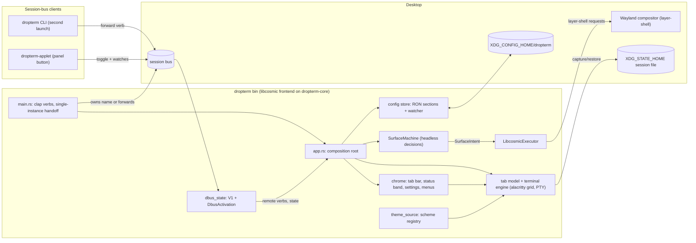
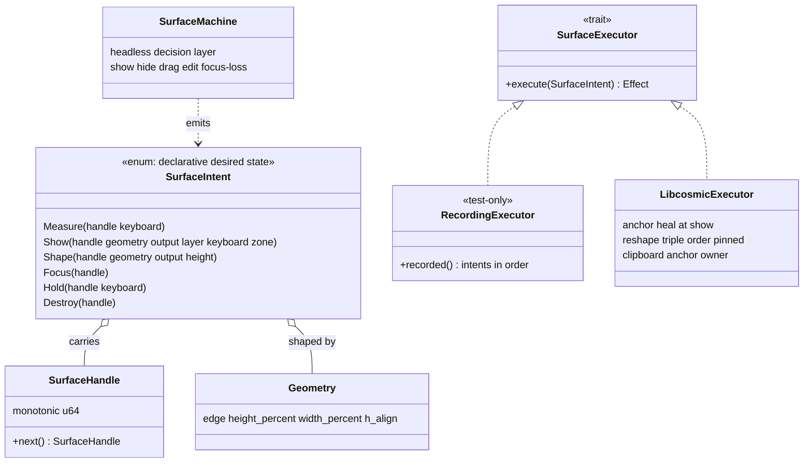

# Architecture

How the DropTerm codebase is laid out: three crates, one module inventory, a handful of load-bearing seams, and where the reasoning behind each lives.

## Three crates, one workspace

- **`dropterm`** (`src/`) - the terminal itself, a bin (the lib target was retired by the shared-core split: nothing it served remains frontend-side). The D-Bus state contract the applet shares lives in the core crate instead of a lib target.
- **`dropterm-core`** (`dropterm-core/`) - the toolkit-neutral core (shared-core split): the config store, session, profiles, the engine, the pure models, and `dbus_state` — the state every frontend and the applet consume.
- **`dropterm-applet`** (`applet/`) - the COSMIC panel applet. A separate process by design: one binary carrying both would unify wgpu features and break panel rendering (the reasoning is in the [research record](research/archive/v3-panel-applet.md)).

## How it connects

One process, one bus name, one surface - and every external touch goes through a seam the diagrams below make visible. GitHub renders these diagrams; the raw markdown carries the same text.

## Module inventory

The recurring split is *pure model* vs *wiring*, and the shared-core split made it a crate boundary: the `core` rows are the toolkit-neutral half both frontends will consume, the `bin` rows the libcosmic wiring that needs a compositor. Unit tests live inline in `#[cfg(test)]` sibling modules (`*/tests.rs` in either crate).

| Crate | Module | Role |
|---|---|---|
| bin | `main.rs` | CLI entry: clap verbs (`--is-visible`, the `ToggleAction` subcommands), TERM env setup; the single-instance handoff decides and forwards through core's `transport` |
| bin | `app.rs` | The `cosmic::Application`: the message enum, update/view, config subscription - the composition root |
| bin | `app/spawn.rs` | Spawn resolution: shell/cmd/profile decisions and the cwd chains (`plain_spawn_cwd`, `live_preset_cwd`) |
| bin | `app/surface_lifecycle.rs` | Frontend wiring of the surface lifecycle: feeds the machine events, maps `ToggleIntent` off the CLI's verbs |
| bin | `app/tab_actions.rs` | Context-menu picks and inline renames funneled into app messages |
| bin | `app/remote.rs` | The CLI verbs handled inside the running instance |
| bin | `app/theme_glue.rs` | The system-palette reader and `set_theme` task - the half of theme glue that talks to libcosmic (the pure decisions are core's) |
| bin | `context_menu.rs` | The terminal context-menu model - rows, labels, item→`terminal::Action` mapping (pure; picks land in the same path keybinds use) |
| bin | `drawer_handle.rs` | The settings drawer's drag-resize handle |
| bin | `executor.rs` | The libcosmic surface executor: translates each intent into today's layer-shell command sequence and owns the clipboard anchor |
| bin | `geometry.rs` | Facade re-export of core's geometry model plus the iced-conversion halves (`anchor_margins`) |
| bin | `grab_bar.rs` | The surface-height drag bar |
| bin | `keybinds.rs` | `to_key_bind` and the libcosmic action mapping - the toolkit half of the chord model |
| bin | `notify.rs` | Bell → freedesktop desktop notification (direct D-Bus; COSMIC has no Notification portal) |
| bin | `settings.rs` | The settings drawer: the write contract, the control→key map, five pages, the profile manager form, the keybind editor |
| bin | `slide.rs` | Re-export of core's slide model beside the `SlideBox` widget and `translation_y` - the draw half of the 130 ms slide |
| bin | `status_bar.rs` | The 28 px status band widget |
| bin | `surface.rs` | Layer-shell surface creation - a measuring pass stretches to the output, then reshapes in place |
| bin | `tab_bar.rs` | The tab strip widget: buttons, `+`, gear, drag reorder, inline rename, per-tab menu, pins, borders |
| bin | `terminal/` | The render widget adapted from cosmic-term: `widget.rs` (`TerminalBox`), `host.rs` (`CosmicHost`, the `TextHost` impl over iced's global font system), `input.rs` (the iced input translation) |
| core | `config.rs` + `config/` | The 43-key on-disk config (`DropTermConfig`) and the plain-RON section store with its watcher contract |
| core | `dbus_state.rs` | The served contract at the owned bus name: the read-only `Visible`/`TabCount` V1 interface and the `org.freedesktop.DBus` activation members a second launch forwards through |
| core | `transport.rs` | The startup transport halves: the bus-name ownership decision, `forward_to_running` (parameterized over the frontend's own verb serialization), `forward_outcome`, the platform-data dictionary |
| core | `intent.rs` | The toolkit-neutral surface intent vocabulary (`SurfaceIntent`, `SurfaceHandle`) and the executor trait |
| core | `surface_lifecycle.rs` | The headless `SurfaceMachine`, its guards, the toggle funnel (`ToggleIntent`), `shown_keyboard_mode` |
| core | `slide.rs` | The 130 ms slide *model*: direction, play state, offset/reverse/finished - machine state, no drawing |
| core | `geometry.rs` | Pure geometry math: percent mapping, drag throttling, the write-back machine |
| core | `keybinds.rs` | The default chord map plus the per-action `custom_key_binds` overlay (pure model) |
| core | `profile.rs` | The profile model and its pure resolution seams (`profile ?? global`, per field) |
| core | `session.rs` | Session persistence: versioned RON schema, capture/restore planning, corrupt-file quarantine, atomic save (pure file layer) |
| core | `tabs.rs` | The pure tab model: insert/close/reorder/cycle, title fallback |
| core | `terminal/` | The engine adapted from cosmic-term: `engine.rs` (PTY + `alacritty_terminal` grid behind the `TextHost` seam), `suggest/` (the autosuggestion model and walker), `host.rs` (the `TextHost` trait - shaping without a toolkit) |
| core | `theme_glue.rs` | The pure theme decisions: `window_bg_color`, `effective_colors`, `effective_is_dark`, `theme_override` |
| core | `theme_source.rs` | The 12-scheme registry with per-scheme license provenance |
| — | `applet/` | The applet crate: the panel button (state-driven opacity, tooltip), the D-Bus watches, the click decision - consumes `dropterm-core` for the contract |

`main.rs` (and the core crate's `lib.rs`) also carry the pedantic-lint table `just clippy` enforces - `standing:` owner-approved exceptions and `transient:` worklist entries that self-clean as their lint class is cleared.

## The load-bearing seams

- **Single-instance D-Bus.** A second launch of the binary never starts a second app: `DropTerm` owns its bus name itself (the control transport, `dbus_state`'s activation interface served beside the V1 contract; libcosmic's `single-instance` feature is gone), and a second launch forwards its verb through `org.freedesktop.DbusActivation` to the running instance. The CLI verbs (`src/app/remote.rs`) and the applet's toggle use the same activation surface; state flows out read-only through `dbus_state`'s V1 interface. Everything on this seam is fire-and-forget by design - it structurally cannot offer replies ([research](research/archive/remote-control-commands.md)). The trust boundary is the session bus: any process in the same session can drive the verbs, including `--cmd`'s shell execution - the same authority the surface always had under the old name, now stated outright.
- **Config as the source of truth.** Every setting lives in plain RON under `$XDG_CONFIG_HOME` (the config store, `dropterm-core/src/config/store.rs`): one file per writer - settings, profiles, keybinds - plus `completions.toml`, all watched live. The settings drawer is a *writer* with the same contract - write-through per commit point, no Apply button - so drawer edits and hand edits are the same event stream to the app.
- **One surface-intent path.** The surface lifecycle decides in the headless `SurfaceMachine` (core's `surface_lifecycle.rs`) and emits declarative intents (`intent.rs`, also core); the libcosmic executor (`executor.rs`, frontend) translates each into today's layer-shell commands, request order included. Every reshape still lands through one geometry triple, so no path can leave a stale anchor, margin, or size.)
- **One spawn funnel.** `app/spawn.rs` decides what a new tab runs - shell, `--cmd`, or profile - and where it starts, composing `new_tab_cwd`/`default_cwd`/profile cwd with explicit degradation, never an error surface.
- **Theme by name.** Schemes are registry names resolved in core's `theme_source.rs`; the profile appearance rule is `profile ?? global` per field, re-resolved on every config pass so live tabs follow edits.

## The adapter surfaces

Every toolkit-shaped or desktop-shaped duty in DropTerm sits behind a named contract, so "which backend answers" is always a lookup, never archaeology. The surface lifecycle is the worked example - a trait with two implementations today - and the rest of the table is the same shape at smaller seams.

| Backend surface | Contract | Implementations |
|---|---|---|
| Surface lifecycle | `SurfaceExecutor` over `SurfaceIntent` (core's `intent.rs`) | `LibcosmicExecutor` (`executor.rs`, frontend); `RecordingExecutor` (core tests) |
| Control transport | V1 interface + `DbusActivation` at the owned bus name (core's `dbus_state.rs`, zbus) | the terminal binary serves; CLI verbs (`app/remote.rs`) and the applet are clients |
| Config backend | section files, one per writer (core's `config/store.rs`) | plain RON + `notify` watcher; settings drawer is just another writer |
| Session backend | versioned RON state file (core's `session.rs`) | capture / restore planning / quarantine / atomic save |
| Theme | scheme registry names resolving to `alacritty` `Colors` (core's `theme_source.rs`) | the 12-scheme registry; `profile ?? global` re-resolved per config pass |
| Clipboard | copy and paste paths (`clipboard.rs`) | wl-clipboard-rs data-control (focus-free serving); the libcosmic runtime binding with its never-destroyed anchor |
| Terminal engine | the `alacritty_terminal` grid (core's `terminal/engine.rs`) | PTY + grid + the two patched forks carrying OSC 133;D passthrough |
| Surface backend dispatch | the startup probe (`main.rs` guard) | registry roundtrip asking for `zwlr_layer_shell_v1`; refuse and exit when absent |

The core crate under the frontends exists (the shared-core split); the second frontend and its GPUI executor joining the trait are the portability initiative's plan, not this page: see the [portability plan](research/portability-plan.md) and its [interactive desktop-seams view](research/porting-architecture.html).

## Testing posture

- **Headless** - the pure modules above carry `#[cfg(test)]` unit tests; `cargo test` (or `just test`) runs them.
- **On hardware** - anything needing a real compositor is verified by the [manual test checklist](testing.md); there is no middle tier by design.
- `just check` (format, clippy `-D warnings`, test) is the change Definition of Done.

## Where the why lives

Module doc-comments carry the local reasoning (dated rulings, gotchas); the feature-level reasoning - peer surveys, recommendations, rejected alternatives - lives in the research records, indexed by the [decision log](research/README.md).
