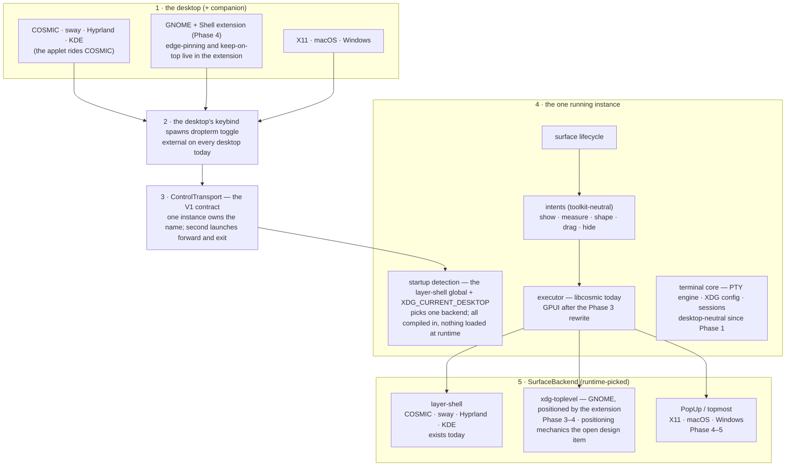

# Plan: how does DropTerm get from COSMIC-only to tiered cross-platform, and in what order?

Date: 2026-11-10 (decision evidence surveyed 2026-11-09; reviewed and
re-verified against the tree and upstream on 2026-11-10, before the record's
first commit)

**This is a plan record, the one maintained exception to record
immutability.** Its evidence sections are fixed. Its capability map, the
Status line of each work package, its checklists, and its results sections
are updated in place while the work runs, under the rules in "Updating this
plan". It supersedes [gpui-migration](archive/gpui-migration.md) and
[portability-roadmap](archive/portability-roadmap.md) (both 2026-11-09,
archived untouched; "Corrections to the superseded records" lists what
changed) and carries the evidence of the same-day gpui-kit survey, which was
never committed as a record of its own. The index row tracks the phase.

## TL;DR

Four verdicts, one order of work:

1. **GPUI can replace libcosmic as a full UI-layer rewrite, gated on a
   hardware spike, and the spike's crux is wider than the superseded records
   said.** Every show creates a full-output measuring surface, then reshapes
   that same surface into the terminal at its first configure: anchor,
   margin, size, layer, keyboard interactivity, and exclusive zone
   (`src/app.rs:3089-3099`). At the surveyed GPUI rev only size and the
   exclusive zone and edge mutate at runtime; anchor, margin, layer, and
   keyboard interactivity are create-only, and only keyboard interactivity
   has an upstream proposal (zed PR #61420, open). A GPUI build therefore
   shapes the surface at creation on every show (a two-surface show, or
   sizing from display bounds) and carries or redesigns around the mid-slide
   keyboard re-grab. Two more open upstream PRs sit on the same path: #61368
   (a zero-size layer surface can get the client disconnected under
   fractional scaling, and the measuring surface is zero-size) and #64994
   (configure sizes override an explicitly requested size).
2. **All platforms are in scope, tiered** (owner ruling): layer-shell
   Wayland the per-release-tested primary; X11, GNOME, and macOS
   milestone-tested secondaries; Windows builds-only until test hardware
   exists. The port rides six compile-time seams; a runtime plugin system is
   rejected.
3. **The rewrite's chrome can adopt gpui-kit (CONDITIONAL-GO; the owner
   rules)** on one structural condition: the Kit's `gpui-pre` crates.io
   snapshots become the sole GPUI source, because a zed git pin and the Kit
   cannot coexist in one dependency graph. Under the Kit every carried GPUI
   patch becomes a fork of the snapshot pipeline, so this review recommends
   ruling after a base spike has counted the patches.
4. **Delivery is a flag day, then lanes.** The identity rename lands first,
   because every later doc, test, and manual step names the final binary;
   then three short-lived lanes run in parallel (two in worktrees of their
   own) beside the hardware reality check and the throwaway spike. Each work
   package below is written to be lifted whole into its own spec.

What keeps the effort bounded:

- Every show already creates a fresh surface and every hide destroys it
  (`Hidden` holds no surface), so GPUI's create-only options cost at most one
  extra surface creation per show; no part of the design leans on a
  long-lived surface.
- No COSMIC session detection exists anywhere in the tree, so wlroots and
  KDE sessions may already work; Phase 0, a no-code hardware checklist,
  either confirms it or writes the Phase 1 bug list.
- The engine's `/proc` reads already sit behind `cfg(target_os = "linux")`
  with non-Linux fallbacks.

## The port at a glance

One picture of the whole initiative: one binary, one contract, and a
surface backend picked at runtime per desktop. The diagram here is the
maintained source of truth for this shape;
[`porting-architecture.html`](porting-architecture.html), beside this
record, is an interactive convenience view of the same content (pick a
desktop, watch its path light up) — on drift, this diagram wins. The
[adapter inventory](#the-adapter-inventory-six-seams-plain-swaps-out-of-core)
below carries the six seams in full.



Per-desktop status (moves with the work packages' Status lines and the
Phase 0 results; this section records the shape, the plan's text makes
the rulings):

| Desktop | Surface path | Status (2026-11-12) |
|---|---|---|
| COSMIC | layer-shell | the known-good baseline; the input-bound Phase 0 rows await the eyes-on pass |
| sway | layer-shell | core checks green in session 2a; keyboard rows (2, 3, 5) and the bell rewalk await hardware |
| Hyprland | layer-shell | expected; session 2b open |
| KDE Plasma | layer-shell | expected; session 3 open |
| GNOME | xdg-toplevel + the Shell extension | blocked on the missing protocol — the guard exits cleanly today; the plain-window backend rides Phase 3, the extension is Phase 4 |
| X11 | PopUp / topmost | guard refuses; the Phase 4 backend's first design input (session 5's dock-band finding) is banked |
| macOS | PopUp | Phase 5 (maybe) |
| Windows | PopUp | builds-only in CI until test hardware exists |

## The decision stack

**Decided** (owner rulings 2026-11-09, evidence below):

- Tiered platforms: all in scope; Wayland layer-shell per-release primary;
  X11/GNOME/macOS milestone secondary; Windows builds-only.
- Test hardware = COSMIC + Linux sessions/VMs + one Mac; Windows later.
- Compile-time seams in a `dropterm-platform` crate; runtime plugins
  rejected (Rust has no stable ABI, and a loader could never carry a macOS
  backend into a Linux binary anyway). Traits inside the binary, contracts
  outside it.
- The V1 D-Bus contract becomes *the* API; D-Bus is its Linux binding.
- Identity renames to plain `dropterm`; greenfield, no backward-compat
  shims; the rename lands with the config-store move in one release.
  (Review reading, 2026-11-10: the pairing is one *release*; the two
  packages merge separately, with no release cut between their merges.
  Owner ruling, 2026-11-12: pre-distribution — no released version, no
  users — nothing to break, so the release carries no break note.)
- gpui-shell (the Kit's JavaScript runtime layer) never enters the
  dependency graph.
- The applet stays COSMIC-only; GNOME comes via a companion Shell extension
  over the contract; KDE/swaybar integrations are out-of-core programs.
- GTK4 anywhere: rejected. Uniform all-OS support: rejected.

**Gated on the base spike (Phase 2)**: the GPUI rewrite itself (GO /
REDESIGN / NO-GO); `iced_layershell` as the Linux-Wayland-only fallback on a
NO-GO; how the GPUI frontend shares the repository with the libcosmic one
during Phase 3 (spike check 14).

**Open, owner rulings:**

1. **The gpui-kit conditional-GO.** Adopt: the GPUI source is the
   `gpui-pre-*` snapshot. Decline: a zed git rev, and the chrome is
   hand-built. Needed before Phase 3 scaffolds.
2. **When to rule on the Kit** (raised by the 2026-11-10 review).
   Recommended: after the base spike, which pins zed git at the exact commit
   the current `gpui-pre` snapshot was cut from, so its results apply to the
   snapshot's code and the ruling can read the carried-patch ledger. The
   2026-11-09 plan ruled first and let the ruling set the spike's pin. The
   roadmap below runs either way: ruled "adopt" before the spike starts, the
   spike pins the snapshot and runs the Kit checks in the same pass.
3. **Live geometry edits under GPUI** (needed at the spike report). A
   width, alignment, or edge edit while shown changes the anchor and margins,
   which GPUI cannot mutate: recreate the surface (the spike measures the
   flicker and re-slide cost) or apply those edits at the next show (height
   edits stay live through `resize`).

## What DropTerm has today (grounding, re-verified 2026-11-10)

**Portable as-is** (no libcosmic types): the `alacritty_terminal` 0.25.1
state machine with the vte/alacritty OSC-133 forks via `[patch.crates-io]`
(`Cargo.toml:47-49`); the config data model (the `DropTermConfig` serde
structs, `completions.toml`); XDG-ron session state (`src/session.rs`); the
`notify-rust` bell path (`src/notify.rs`); profiles (`src/profile.rs`); the
scheme registry (`src/terminal/theme_source.rs`); fontdb enumeration
(`src/font_list.rs`); the suggest engine and its walker
(`src/terminal/suggest.rs`, whose only toolkit-adjacent item is the
`ghost_color` render helper at `:2160`) and the external generators. No
COSMIC session detection exists: nothing reads `XDG_CURRENT_DESKTOP`,
`DESKTOP_SESSION`, `XDG_SESSION_TYPE`, or `WAYLAND_DISPLAY`, and nothing
probes for the layer-shell global. The environment reads are `HOME`,
`SHELL`, `PATH` (`src/config.rs:684,709`, `src/app/spawn.rs:279,292`), the
XDG base directories (`src/session.rs:462`, `src/terminal/suggest.rs:968`),
the Flatpak probe's `FLATPAK_ID` and `HOST_XDG_CONFIG_HOME`
(`src/app.rs:1997-2000`), and one debug switch
(`src/terminal/engine.rs:3311`).

**Portable logic behind a libcosmic seam** (each needs cutting before a
second frontend can share it):

- Clipboard: `src/clipboard.rs` drives the data-control protocol through
  `wl-clipboard-rs`, but hands results back as `cosmic::iced::Task` and falls
  back to the iced clipboard (`:26`, `:633`).
- Control: `src/dbus_state.rs` serves the V1 contract over zbus, but
  bus-name ownership and second-launch forwarding belong to libcosmic's
  `single-instance` feature: `cosmic::app::run_single_instance`
  (`src/main.rs:149`) and `Application::dbus_activation` receiving
  `ActivateAction` (`src/app.rs:2785-2791`).
- Text shaping: the engine builds `cosmic-text` buffers through iced's
  global font system (`src/terminal/engine.rs:36`, `:1378`, `:3042`). That is
  render-path code; a GPUI renderer that paints from the grid, as Zed's does,
  replaces it.
- Config persistence: `cosmic-config` (the derive at `src/config.rs:10,186`;
  the handle and watcher at `src/app.rs:2068,2320`; the three `persist`
  writers at `src/settings.rs:651,2096,2120`; the `completions.toml` path
  hand-built from the cosmic config directory at `src/app.rs:1993-2008`; 40
  `with_custom_path` uses in `src/config/tests.rs`). libcosmic's
  `dbus-config` feature (in the `terminal` feature list of `Cargo.toml`)
  routes libcosmic's own config watching through cosmic-settings-daemon.
- The hostname read (`src/app.rs:1985`) is the one `/proc` read without a
  `cfg(target_os = "linux")` gate.

**The rewrite surface**: 34 `.rs` files reference `cosmic::` (30 under
`src/`, 4 under `applet/`; three of them test files). The app framework
(`cosmic::app::run_single_instance`, `src/main.rs:149`); the theme glue
(`src/app/theme_glue.rs`); nine custom iced widgets: the terminal grid
`TerminalBox` (`src/terminal/widget.rs:530`; the file is 3,664 lines and
carries the suggest overlay and inline images), the status band
(`src/status_bar.rs:2500`), the tab bar (`src/tab_bar.rs:1444`), the slide
(`src/slide.rs:221`), the grab bar (`src/grab_bar.rs:85`), the drawer handle
(`src/drawer_handle.rs:90`), the backdrop (`src/app.rs:1646`), and the font
and scheme pickers (`src/settings/font_picker.rs:205`,
`src/settings/scheme_picker.rs:315`); and the layer-shell command surface
(`src/surface.rs`, `src/geometry.rs:96-170`, `src/app.rs:23-26`).

**The Linux-bound code a cross-OS build must seam**: `/proc` reads for the
foreground process name, its command line, and the live cwd
(`src/terminal/engine.rs:430,483,1706`), each already gated with a non-Linux
fallback; `tcgetpgrp`/`getpgid` on the PTY master
(`src/terminal/engine.rs:378-379,411-412,457-458`; POSIX, so macOS yes,
Windows no); `wl-clipboard-rs` (Wayland-only); zbus IPC (`src/main.rs:88`,
`src/dbus_state.rs`); `APP_ID` = `io.github.l1br3_io.CosmicExtDropterm`
(`src/lib.rs:37`); the `COSMIC Dark/Light` scheme defaults
(`src/config.rs:33-36`) and the `Noto Sans Mono` default font
(`src/config.rs:587`).

**The chrome surface** (the hand-build backlog if the Kit is declined): the
settings drawer (`src/settings.rs`, `src/settings/view.rs`: dropdowns at
`view.rs:484,1070,1150`, slider `:1108`, toggler `:1203`, fourteen-plus
rendered text inputs, sixteen distinct buttons, segmented-button nav
`:31,34`, tooltips `:366,377,860`, list `:344`), the `Section` enum
control→key contract (`src/settings.rs:48-58`), the font and scheme pickers,
the context and per-tab menus (`src/context_menu.rs`, `src/tab_bar.rs`,
`src/keybinds.rs:19`), the tab bar with drag-reorder (`src/tab_bar.rs`,
`src/tab_bar/reorder.rs`), the status band (`src/status_bar.rs`). Grab bar,
drawer handle, and slide are surface geometry; they become GPUI primitives
whichever way the Kit ruling goes.

**The identity's reach** (sizes the rename): outside the research log, 41
tracked files carry `CosmicExtDropterm`, `cosmic-ext-dropterm`, or
`cosmic_ext_dropterm` (52 counting `Cargo.lock`, which regenerates, and the
research records, which keep the old names because records are immutable). In
code, `APP_ID` (`src/lib.rs:37`, its `.Dev` twin at `:46`) feeds the Wayland
app id, the bus name and object path (`src/dbus_state.rs:26` onward), the
layer-shell namespace (`src/surface.rs:26`), the cosmic-config namespace, the
state directory (`src/session.rs:467`), and the completions data seat; the
applet hardcodes its `….Applet` ids (`applet/src/applet.rs:134,138`). Around
it: six `res/` files named by the id (desktop entries, metainfo, icons), the
package, binary, and library names (`Cargo.toml:2,12,16`), the justfile
(`:25-26` and the dev recipes), both CI workflows, `scripts/vm.sh`,
`data/completions.toml`, README, ROADMAP, 13 `docs/` pages, and the release
skill. Public artifacts already carry the old names: the published GitHub
releases (v0.4.0's assets are `cosmic-ext-dropterm-0.4.0-<arch>.tar.gz`),
and README's uninstall steps name the `io.github.l1br3_io.CosmicExtDropterm*`
files they install.

**What ships to other distros today**: the GitHub release tarball (x86_64
and aarch64 `usr/` trees, built on `ubuntu-24.04` runners) and source builds
through `just deps` (apt, dnf, pacman, zypper). A local release build
references `GLIBC_2.39` symbols, so the tarball needs glibc 2.39 or later:
Debian 12 and Ubuntu 22.04 cannot run it (measured on a local build; the CI
tarball builds on the same Ubuntu base). The deb, AUR, and nix channels in
the [packaging record](archive/packaging-and-release.md) were proposed and
never built.

**The terminal surface's lifecycle** (the spike's subject):

- `show()` creates a fresh measuring surface
  (`src/app/surface_lifecycle.rs:243-255`, shaped by `src/surface.rs:95-115`):
  `Overlay` layer, anchored to all four edges, size `(None, None)`
  (compositor-assigned), exclusive zone `-1`, output `Active` (the
  compositor's choice), keyboard interactivity already the shown mode (the
  map-time focus grant).
- At its first configure, `SurfaceOpened` reshapes that same surface into
  the terminal (`src/app.rs:3089-3099`): the anchor/size/margin triple
  (`geometry::apply_geometry`, `src/geometry.rs:150-170`), `set_layer` to the
  configured layer, a keyboard-interactivity re-assert, and
  `set_exclusive_zone` for `respect_panel`. The surface is never recreated in
  between (the comment on its `namespace` field in `src/surface.rs`).
- While shown, grab-bar drags re-send the triple at an 80 ms cadence with a
  16 px deadband (`DRAG_APPLY_INTERVAL`, `src/geometry.rs:280`), and a
  geometry edit in the drawer re-sends it live (`ConfigChanged`,
  `src/app.rs:2975-2986`); a width or alignment edit changes the anchor and
  margins (`anchor_margins`, `src/geometry.rs:96-130`). The granted-size echo
  is debounced at 150 ms (`WINDOW_PIN_INTERVAL`, `src/geometry.rs:318`).
  Layer, keyboard-mode, and `respect_panel` edits are `NextShow`
  (`src/settings.rs:1034-1035`), so none of them touches a live surface.
- Keyboard interactivity also mutates on a live surface in three places:
  released at slide-out start so the previous window regains focus
  (`src/app/surface_lifecycle.rs:331`), re-grabbed on a mid-slide reversal
  (`:403`), and released when a stay-open flip lands while `Exclusive` is
  held (`src/app.rs:2911`).
- `hide()` destroys the surface, at once for a measuring surface
  (`src/app/surface_lifecycle.rs:284-290`) or after the slide-out
  (`src/app.rs:3691`); `Hidden` holds no surface. Focus events drive
  `hide_on_focus_loss` (`src/app/surface_lifecycle.rs:173-189`, dispatched at
  `src/app.rs:3141,3150,3303`).
- A second surface, the clipboard anchor, has its own lifecycle: opened
  before the first layer surface (`src/app.rs:1972-1976`), a 1×1 layer
  surface by default or a mapped window under `show_in_dock`, destroyed and
  reopened on a presence flip (`swap_anchor`, `src/app.rs:2018-2024`), and
  marked `Lost` when the compositor closes it with its output, then reopened
  at the next show (`heal_anchor`, `src/app.rs:1955`).
- The pure decision layer (`toggle_step`, `config_edit_reshapes`, the focus
  predicates) has about 25 headless tests
  (`src/app/surface_lifecycle.rs:793-1122`), but its types carry iced's
  `window::Id`, and the executors (`show`, `hide`, `reverse_show`,
  `focus_lost`, `debounced_toggle`) return `cosmic::app::Task` directly with
  no headless coverage.

## GPUI: the facts that gate the rewrite

Surveyed at zed `main` rev `ec237216460f8a34a4ac7c6b068e838593976ede`
(2026-11-09); re-checked against zed `main` and the GitHub API on
2026-11-10, with no change to any item below.

- **The pin is the product.** Zed's workspace root sets `publish = false`;
  crates.io `gpui` is frozen at 0.2.2 (2025-10-22), a year stale and
  predating the mid-2026 layer-shell fixes. External consumers pin zed git,
  or, via the Kit, the `gpui-pre` snapshots. The platform layer is now
  per-OS crates (`gpui_linux` with separate `wayland`/`x11` features,
  `gpui_macos`, `gpui_windows`, the `gpui_platform` aggregator); any pin
  must cover the whole set, `gpui` included.
- **Layer-shell exists and maps.** `WindowKind::LayerShell(LayerShellOptions)`
  carries namespace/layer/anchor/exclusive_zone/exclusive_edge/
  keyboard_interactivity/margin, the same vocabulary as
  `SctkLayerSurfaceSettings` (`src/surface.rs`). History: added 2025-07-29
  (PR #32651), reverted the next day after it panicked on Linux Wayland (PR
  #35331), re-landed 2025-10-29 (PR #35610), `wayland` feature only.
- **Runtime mutation at the surveyed rev**: `Window::resize` (dispatches to
  `layer_surface.set_size`), `Window::set_exclusive_zone`, and
  `Window::set_exclusive_edge` (PR #60163, merged 2026-07-15). Create-only:
  anchor, margin, layer, keyboard interactivity. Only keyboard interactivity
  has a proposal, `Window::set_keyboard_interactivity` in PR #61420 (open
  since 2026-07-21); no PR proposes anchor, margin, or layer setters.
- **Open PRs on DropTerm's path** (all open on 2026-11-10):
  - #61368, "Fix compositor-assigned Wayland layer-shell dimensions": when a
    fractional-scale event arrives before the first configure, a zero
    (compositor-assigned) dimension reaches `wp_viewport.set_destination`
    and the compositor disconnects the client. DropTerm's measuring surface
    requests exactly that zero size on every show.
  - #64994, "Fix wayland layer shell sizing": GPUI treats configure sizes as
    authoritative, so a full-output configure can overwrite an explicitly
    requested size. DropTerm's shown surface requests an explicit height.
  - #61578, output discovery enforced at startup (the open half of issue
    #46378).
- **The crux, operation by operation** (what a GPUI executor must do for
  each thing DropTerm does to a surface today):

| DropTerm operation (code anchor) | When | GPUI at the surveyed rev | GPUI path | Spike check |
|---|---|---|---|---|
| Measure the output with a zero-size, all-edge surface (`src/surface.rs:95-115`) | every show | creatable; #61368 disconnect risk under fractional scale | carry #61368, or size from display bounds and skip measuring | 1 |
| Shape the terminal: anchor, margin, layer, keyboard, zone (`src/app.rs:3089-3099`) | every show, at first configure | create-only, except zone | shape at creation: a two-surface show (measure, destroy, create shaped) or a measure-free show | 1 |
| Height during grab-bar drags (`src/geometry.rs:280`) | 80 ms cadence | `Window::resize` | compositor behavior at the cadence; #64994's configure handling | 2, 7 |
| Width, alignment, or edge edit while shown (`src/app.rs:2975-2986`) | drawer edit | anchor and margin create-only | recreate, or apply at next show (open ruling 3) | 2b |
| Keyboard release at slide-out, re-grab on reversal, stay-open release (`src/app/surface_lifecycle.rs:331,403`, `src/app.rs:2911`) | hide, reversal, config echo | create-only | carry #61420, or redesign | 3 |
| Layer, keyboard-mode, `respect_panel` edits (`src/settings.rs:1034-1035`) | next show | applied at creation | none needed | 4 |

- **The carried-patch ledger.** On a zed git pin, each upstream PR the spike
  needs (#61420, #61368, #64994, and any setter DropTerm writes itself)
  becomes a carried patch, the vte/alacritty forks being the house
  precedent. Under the Kit each becomes a fork of the `gpui-pre` publishing
  pipeline (Kit issue #3168). The spike report states the ledger; the Kit
  ruling reads it.
- **Output selection is fixed.** PR #50520 (merged 2026-03-08) resolves
  display targeting for layer surfaces; `cx.displays()` is populated at
  startup at the surveyed rev. Issue #46378 remains open for enforcement
  only (PR #61578).
- **alacritty_terminal on GPUI is proven and packaged.** Zed's own terminal
  is exactly that pairing (`crates/terminal` depends on both), and its
  `TerminalElement` paints cells from the grid through GPUI's text batching
  (`BatchedTextRun`), so DropTerm's engine-side `cosmic-text` buffer layer is
  replaced rather than ported. The community `gpui-terminal` crate is
  reference material only (one release, 2025-12-24, MIT OR Apache-2.0, pins
  the frozen crates.io gpui: vendored or patched material at best). The
  `[patch.crates-io]` forks resolve workspace-wide, so the OSC-133 forks
  still apply.
- **cosmic-text stays**, relocated into `gpui_wgpu` (0.19.0). A GPUI
  migration removes libcosmic and the COSMIC desktop coupling; it keeps one
  pop-os crate, so a literal "zero pop-os code" goal fails under GPUI.
- **`WindowKind::PopUp` is the drop-down candidate everywhere layer-shell
  does not exist** (X11, macOS, Windows; plausibly GNOME's toplevel too),
  unverified as a hotkey-window substitute; spike checks 12–13.

## gpui-kit: the chrome decision (CONDITIONAL-GO, the owner rules)

Longbridge's component ecosystem built *on top of* Zed's GPUI; "GPUI"
everywhere else in this plan means the framework itself. Surveyed at Kit
v0.9.1 / gpui-pre 0.3.12 (2026-11-09); both still current on 2026-11-10.

**The structural fact**: since 2026-09-03 (PR #2929) the Kit consumes GPUI
as `gpui-pre-*` crates.io snapshots, exact-pinned (`=0.3.12` = zed
`d2a4fb6`, committed 2026-11-08 20:08, published 2026-11-09 00:30), weekly
(13 versions in ten weeks), under a day behind zed `main`, covering the
whole per-OS platform split (29 `gpui-pre-*` crates). A `[patch]` cannot
rename crates (the Kit's own PR #3332 documents the mechanism), so a zed git
pin and the Kit in one tree means two incompatible GPUI copies. **Adopting
the Kit means the snapshot is the GPUI source**, for the Kit pass of the
spike and for everything after it. The earlier idea of patching the Kit down
to a spike rev is retired.

**Coverage** (catalog at v0.9.1 mapped onto the grounding): dropdowns →
Select/Combobox/DropdownButton; slider → Slider; togglers → Switch/Toggle/
Checkbox; buttons → Button; context and per-tab menus → Menu (right-click,
Action/KeyBinding integration, the counterpart of `src/keybinds.rs:19`);
picker popovers → Popover (the picker *contents* stay custom); text inputs
→ Input/Textarea; lists → List/VirtualList; the tab bar → Tabs/Dock
(DropTerm's drag-reorder close/pin semantics stay custom on top); tooltips
→ Tooltip; drawer nav → Tabs/Settings pages; **the settings drawer → the
`Settings` component (since v0.5.0)**: SettingPage → SettingGroup →
SettingItem → SettingField with switch/checkbox/input/dropdown/number_input
fields, search, and resettable, mapping near 1:1 onto the `Section` enum
and its control→key contract. Stays custom either way: keybind capture,
drawer geometry (grab bar/handle/slide), picker contents, the status band.
(`docs.rs` rustdoc coverage is 60.21%; the docs site is the real
documentation surface.)

**License**: Apache-2.0 on every published version of all four crates
(`gpui-kit`, `gpui-component`, `gpui-base`, `gpui-shell`), which the FSF
rules one-way compatible with GPL-3.0-only; CC BY 4.0 for docs prose.
DropTerm keeps its license; the conditions are notice retention (§4(a)),
NOTICE-file carriage (§4(d)), and stating modified files (§4(b)).

**Separability**: gpui-component does not depend on gpui-shell; base-only is
a supported posture. Component-only adoption satisfies the runtime-plugin
rejection untouched. Window creation stays embedder-owned: DropTerm keeps
`cx.open_window` with `WindowKind::LayerShell` and wraps the chrome view in
`Root` manually ("layer-shell windows do not require Root configuration";
the docs' "or equivalent manual wrapping" acknowledges the path). Root is
per-window: the chrome window carries one; the measuring surfaces, clipboard
anchor, and dock-presence surface need none.

**Health and risks**: weekly releases, 20,065 stars, ~500k downloads,
Longbridge Pro production use (self-reported), unusually good
breaking-change release notes (v0.8.1 enumerates upstream GPUI breaks with
migration guidance). The standing risk is concentration: the top two
contributors make ≈ 75% of commits, and one person (huacnlee) publishes
every checked release. Between-pin churn is real (#3156, 2026-09-21: a
gpui-pre bump broke v0.6.4 consumers; contained in ~2.5 h, exact-pin
enforcement added) but documented at release boundaries. The fork escape
under the Kit is heavier than a rev pin: forking the publication pipeline
(issue #3168), which also means carrying any zed PR through the Kit is a
pipeline fork; every entry in the carried-patch ledger multiplies that cost.

**Go/no-go (8 criteria)**: license **PASS**; single pin **PASS by
adoption** (the snapshot replaces the git pin; no reconciliation); chrome
coverage **PASS**; theming **PASS with a generation step** (scheme colors →
theme-JSON → `ThemeRegistry::apply_config`; themes are `#[non_exhaustive]`
since v0.9.0, so no struct literals); no runtime plugin **PASS**;
layer-shell compatibility **LIKELY PASS, spike checks open** (the docs
contemplate layer-shell; no field evidence exists either way: no issue
reports using or failing the Kit in a layer-shell window); maintenance
**PASS with the concentration risk**; snapshot channel = **the decision
item**.

**The conditions** (checkable facts):

- **C1: the snapshot is the sole GPUI source.** With the Kit adopted,
  DropTerm pins `gpui-pre-*` at one exact version as its only GPUI, and spike
  checks 0–4 must pass on that snapshot. (Sequencing: the base spike pins zed
  git at the commit the snapshot was cut from, and `kit-pass` re-runs 0–4 on
  the snapshot itself; ruled before the spike, the spike pins the snapshot
  directly.)
- **C2: two Kit checks in the spike.** (a) The wayland/layer-shell feature
  set is reachable through gpui-pre's manifest by a consumer. Answered at the
  manifest level on 2026-11-10: `gpui-pre` 0.3.12 declares a `wayland`
  feature (the gate on `WindowKind::LayerShell`), and `gpui-pre-platform`
  0.3.12's `wayland` forwards to its Linux crate, which the Kit's own
  manifest already enables; a consumer build that maps a `LayerShell` window
  remains the proof. (b) Root + Kit overlays (menu, tooltip) render and
  behave on a `LayerShell` surface during the 80 ms reshape cadence.
- **C3: component-only adoption.** gpui-shell never enters the graph; the
  Kit aggregate's `application()`/`open_window` helpers are not used for
  DropTerm-owned surfaces (measuring surfaces, clipboard anchor, dock
  presence, the chrome window itself).
- **C4: the theme path is proven in the spike.** The scheme → theme-JSON
  generator exists as a spike artifact and applies through
  `ThemeRegistry`/`apply_config` on the snapshot pin.
- **C5: a written bump procedure.** Kit + gpui-pre bump together at the
  Kit's release boundary, lockfile committed, release notes scanned for
  upstream-GPUI breaks before each bump (v0.8.1's notes are the template);
  the pipeline fork is the documented fallback (house fork precedent).

If any condition fails on the snapshot pin, the Kit is NO-GO *for that pin*
and the chrome is hand-built; the chrome inventory above is the backlog.
Either outcome leaves the six seams and the roadmap unchanged.

## The adapter inventory: six seams, plain swaps, out-of-core

| Seam | Linux Wayland | Linux X11 | macOS | Windows | Anchor today |
|---|---|---|---|---|---|
| `SurfaceBackend` | layer-shell | `PopUp`/topmost | `PopUp` | `PopUp` | `src/surface.rs`, `src/app/surface_lifecycle.rs`; two surface kinds today (the terminal and the clipboard anchor) |
| Clipboard | data-control (keep) | X11 path or toolkit clipboard | GPUI clipboard | GPUI clipboard | `src/clipboard.rs` |
| `ThemeSource` | XDG portal `color-scheme` | portal or toolkit | GPUI `WindowAppearance` (likely) | same | `src/app/theme_glue.rs`, `src/config.rs:33-36` |
| `Hotkey` | external binding / GlobalShortcuts portal (none on COSMIC today, [known issues](../known-issues.md)) / X11 grab | same | native hotkey API | `RegisterHotKey` | none; the summon is external today |
| `ControlTransport` | D-Bus, owning its bus name (libcosmic's `single-instance` owns it today) | D-Bus | local socket | named pipe | `src/dbus_state.rs`, `src/main.rs:88,149` |
| `ProcessInfo` | `/proc` + `tcgetpgrp` (already `cfg`-gated) | same | libproc (`proc_pidpath`/`proc_pidinfo`) | `CreateToolhelp32Snapshot` + `QueryFullProcessImageName` | `src/terminal/engine.rs:378-483,1706`, `src/app.rs:1985` |

Design rules:

1. **`SurfaceBackend` is one impl per protocol.** Compositor differences
   (cosmic-comp's focus fixup, documented at `src/config.rs:216` and
   resolved in `surface::shown_keyboard_mode`, and its configure-echo
   behavior) live as tuning knobs inside the layer-shell impl.
2. **`ControlTransport` is the structural seam**: the V1 contract becomes
   the API, so `dropterm toggle`/`--is-visible` behave identically
   everywhere and ecosystem consumers stop being Linux-bound by
   construction.
3. **Traits inside the binary, contracts outside it.** Every backend is
   compiled in; startup picks one by runtime detection (the
   `zwlr_layer_shell_v1` global plus `XDG_CURRENT_DESKTOP`/
   `DESKTOP_SESSION`), and nothing is loaded at runtime.
4. **`ThemeSource` grows a generation step under the Kit** (scheme →
   theme-JSON → registry, ~18 scheme colors feeding ~50+ token keys);
   without the Kit it is a direct trait impl.
5. **A seam lands with its second implementation** (2026-11-10 review). A
   trait, and the `dropterm-platform` crate that holds the traits, appears
   when a second implementation exists (the GPUI executor, a macOS backend)
   or when the seam itself buys headless testing (`surface-intents`, whose
   recording executor is its second implementation). Until then the Linux
   code stays plain, so Phase 1 builds no trait without a second user.

Plain work, no traits: the config store (cosmic-config → plain XDG ron on
the `src/session.rs` pattern), per-OS paths and hostname functions, the
identity rename. Out-of-core: panel presence (the applet stays COSMIC-only;
GNOME Shell extension / KDE widget / swaybar module are separate programs
over the contract). No adapter needed: notifications (`notify-rust` 4.18 has
macOS `mac-notification-sys` and Windows `winrt-notification` backends; the
bell path may port nearly free, unverified in practice).

The one named gap: **Windows has no documented Win32 API for another
process's command line** (the `/proc/pid/cmdline` equivalent needs WMI
`Win32_Process` or undocumented `NtQueryInformationProcess`). That powers
the suggest and live-cwd features; a real Phase 5 design item.

## Corrections to the superseded records

The superseded records stay as written; these are the 2026-11-10 review's
corrections, each re-verified in the tree:

1. [gpui-migration](archive/gpui-migration.md) finding 3 described the
   measure-then-reshape-in-place step correctly;
   [portability-roadmap](archive/portability-roadmap.md) finding 4's "the
   per-show destroy/create architecture absorbs the rest" holds for hide and
   show and misses the shape step at first configure, which mutates anchor,
   margin, layer, keyboard, and zone on every show. The crux table above
   replaces finding 4's three-mutation list.
2. portability-roadmap finding 4 item 3 cited `src/app.rs:3091-3099` as a
   live layer and zone change on config edit. Those lines are the per-show
   shape step inside `SurfaceOpened`; layer, keyboard-mode, and
   `respect_panel` edits apply at the next show (`src/settings.rs:1034-1035`).
3. portability-roadmap's grounding called the clipboard anchor "the only
   never-destroyed surface". A presence flip destroys and reopens it
   (`src/app.rs:2018-2024`), and the compositor can close it (the `Lost`
   state).
4. gpui-migration counted "five custom iced widgets". There are nine, the
   terminal grid itself (`TerminalBox`) the largest.
5. Both records listed the clipboard, the D-Bus contract, and the engine as
   surviving untouched. Each carries a libcosmic seam (grounding, second
   tier).
6. portability-roadmap's grounding said packaging was already native-first
   with deb/AUR/nix. Only the GitHub tarball ships, and it needs glibc 2.39
   or later.
7. portability-roadmap's Phase 0 used `dropterm`, `dropterm toggle`, and
   `just build`. Until `app-identity` lands the binary is
   `cosmic-ext-dropterm`, and the release recipe is `just build-release`.
8. Neither record knew of zed PRs #61368 and #64994, both on the measuring
   and resize path.

## The capability map

Module ids are chosen once and never renamed. Each package's block below
carries what its spec needs; its Status line is the only line a package
branch edits in this plan.

| Id | Phase | Kind | Depends on | Lane | Shares hot files with |
|---|---|---|---|---|---|
| `reality-check` | 0 | manual, no code | none | hardware | none |
| `app-identity` | 1 | code, `res/`, CI, docs; mechanical | none | flag day | every package (mostly docs) |
| `config-store` | 1 | code | `app-identity`* | B | `surface-intents` (`src/app.rs`), `control-transport` (`Cargo.toml` features) |
| `surface-intents` | 1 | refactor + tests | `app-identity`* | A | `config-store` (`src/app.rs`) |
| `control-transport` | 1 | code | `app-identity`*, after `config-store` in lane B | B | `layer-shell-guard` (`src/main.rs`) |
| `layer-shell-guard` | 1 | code, small | `app-identity`* | C | `control-transport` (`src/main.rs`) |
| `keybind-docs` | 1 | docs | `app-identity`, `reality-check` | C | none |
| `contract-docs` | 1 | docs | `control-transport` | C | none |
| `distro-reach` | 1 | release and packaging | `reality-check`, `app-identity` | C | `.github/workflows/release.yml` |
| `gpui-spike` | 2 | throwaway crate + report | none | spike | none (own workspace) |
| `kit-pass` | 2 | spike second pass | `gpui-spike`; the Kit ruled "adopt" | spike | none |
| Phase 3 slices | 3 | the rewrite | spike GO or REDESIGN; the Kit ruling; `surface-intents`, `config-store`, `control-transport` | main, as a second binary | ids assigned at the spike report |
| Phase 4–5 | 4–5 | X11, GNOME extension, macOS, Windows | Phase 3 | | ids assigned when each opens |

\* A merge-order dependency only: the package may start before
`app-identity` merges and rebases onto it. `app-identity`'s code diff is
small (about twenty identity literals in `src/lib.rs`, `src/dbus_state.rs`,
`applet/src/applet.rs`, and `applet/src/main.rs`, plus the crate names);
most of its 41 files are `res/`, CI, the justfile, and docs.

Build order: `app-identity` merges first and every other package merges
after it; packages may start earlier and rebase, and `config-store` should,
to keep the gap between the two merges short. `reality-check` and `gpui-spike` run
from day one beside everything; Phase 3 follows the spike report.

## Work packages

### `reality-check`: does today's binary work off COSMIC?

**Status**: in progress — four of seven sessions filled (2026-11-11:
COSMIC, sway, X11, non-Pop distro, all agent-run; GNOME, KDE, and
Hyprland remain owner-hardware sessions, and the input-bound rows of
the filled sessions want one eyes-on pass each).

**Objective.** Learn what the shipped binary does outside COSMIC before
writing code. Green results on sway, Hyprland, and KDE collapse "other
distros" into packaging and docs; every failure becomes a Phase 1 bug.

**Scope.** The sessions and checks in "Phase 0: the checklist". No code and
no worktree: it runs the v0.4.0 release tarball (what users install), or a
`just build-release` where a session's glibc is older than 2.39.

**Feeds.** `layer-shell-guard` (how GNOME and X11 fail), `keybind-docs`
(which bindings work where), `distro-reach` (the glibc floor, missing
libraries and fonts), and new bug packages. Shares the sway session with
`gpui-spike`.

**Success criteria.**
- Every session slot under "Phase 0 results" is filled per the recording
  template.
- Each failure is filed as a bug package or fixed in a commit, named in the
  session's slot.

**Size.** Seven sessions × sixteen checks; manual.

### `app-identity`: one name everywhere

**Status**: merged (f698083).

**Objective.** DropTerm's runtime and packaging identity becomes plain
`dropterm`, so no name ties it to COSMIC. It merges first, because every
later doc, test, and manual step names the final binary.

**Scope.** In: `APP_ID` and its `.Dev` twin (`src/lib.rs:37,46`) and
everything derived from them (Wayland app id, bus name, layer-shell
namespace, state directory, completions data seat); the D-Bus literals in
`src/dbus_state.rs` (the object paths and the `….V1` interface name at
`:32-38`, the `interface`/`proxy` attributes, the pinning tests); the
package, binary, and library names (`Cargo.toml:2,12,16`) and every
`cosmic_ext_dropterm::` path; the applet's dependency name and its
hardcoded ids (`applet/src/applet.rs:23-26,134,138` and its tests, the
desktop and icon paths in `applet/src/main.rs`); the six `res/` files named
by the id,
renamed, with their `Exec=`, `Icon=`, and AppStream ids; the justfile
(`name`, `appid`, the dev launcher and kill patterns); both CI workflows
(desktop-file and metainfo validation paths, the release tarball name);
`scripts/vm.sh`; `data/completions.toml`; README, ROADMAP, the `docs/`
pages, and the release skill. Out: the config store's location beyond what
`APP_ID` derives (`config-store` owns it); renaming the GitHub repository
(an outward-facing act, the owner's); README's "From a release" section,
which keeps describing the published v0.4.0 assets until the next release
rewrites it.

**Constraints already decided.** Plain `dropterm`; no shims, no migration
code, no dual bus names (owner ruling). Ships in the same release as
`config-store`.

**Success criteria.**
- Over tracked files, `rg -i 'cosmicextdropterm|cosmic-ext-dropterm|cosmic_ext_dropterm'`
  matches only the deliberate survivors (the released-install section,
  release-notes history, archived research records), each listed in the
  merge's description.
- `just check` is green, the `dev-identity` builds included, and CI
  validates the renamed desktop and metainfo files.
- The test pinning the object path to the app id passes under the new id.
- Manual: an installed build answers `dropterm toggle`, `show`, `hide`, and
  `--is-visible` over the new bus name, and the rebuilt applet toggles it.
- The release that ships it carries the break note: the old binary,
  desktop, metainfo, and icon files to remove (the v0.4.0 uninstall globs),
  and the old config and state directories that are no longer read.
  Superseded (owner ruling, 2026-11-12): pre-distribution — no released
  version, no users — so no break note; the draft in merge f698083's
  description is moot.

**Ruled (2026-11-10, owner).** App id `io.github.l1br3_io.dropterm`; applet
binary `dropterm-applet`, desktop id `io.github.l1br3_io.dropterm.Applet`;
the GitHub repository renames now, with the flag-day merge — the sweep
writes the new URLs (org `l1br3-io`, repo `dropterm`), the rename act
itself staying the owner's.

**Size.** L by file count, mechanical: a scripted sweep plus hand review,
one merge.

### `config-store`: plain XDG configuration

**Status**: merged (f5199ec).

**Objective.** Settings persist as plain ron owned by DropTerm under
`$XDG_CONFIG_HOME`, following the `src/session.rs` pattern, and
`cosmic-config` leaves the terminal crate; configuration behaves the same on
any desktop and under any toolkit.

**Scope.** In: load at startup; atomic writes (temporary file plus rename)
and quarantine of an unreadable file, as `src/session.rs` does; the three
writers (`PlannedWrite`, `ProfileWrite`, `KeybindsWrite`,
`src/settings.rs:651,2096,2120`); live reload of external edits, replacing
`cosmic_config::config_subscription` (`src/app.rs:2320`) while keeping the
echo-driven apply that `ApplyTiming` relies on; the `completions.toml`
location (`src/app.rs:1993-2008`); the 40 test fixtures; the paths in
[configuration](../configuration.md). Out: migrating the cosmic-config files
(greenfield ruling).

**Constraints.** `every_config_key_is_documented` stays green. A
file-watcher crate would be a new direct dependency, an ask-first decision.

**Success criteria.**
- Round-trip, corrupt-file quarantine, and default-on-missing tests pass
  against a temporary directory.
- An external edit applies live (a headless test where the watcher allows,
  a manual row otherwise), and the drawer's own writes still apply once.
- `cosmic_config` appears nowhere under `src/`; `just check` green; the
  configuration doc names the new path.

**Open for its spec.** One file or one per section (cosmic-config stores
one file per key, so a drawer write and an external edit never collided; a
single file needs a merge rule); the watcher (a crate, or re-reading at
show); the exact path and file name; whether libcosmic's `dbus-config`
feature goes too (it also routes libcosmic's own config and theme watching
through cosmic-settings-daemon, so dropping it changes how the COSMIC theme
follow is watched: verify on COSMIC). The watcher is ruled (2026-11-10,
owner): `notify` sanctioned.

**Size.** L.

### `surface-intents`: a toolkit-neutral surface vocabulary

**Status**: merged (00cf77d).

**Objective.** The surface state machine and the reshape paths emit
toolkit-neutral intents, and a libcosmic executor turns them into today's
layer-shell commands. The whole lifecycle becomes headless-testable, and the
GPUI port becomes a second executor.

**Scope.** In: the terminal surface's show, measure, shape, drag, live
edit, slide-out, reversal, hide, and focus paths
(`src/app/surface_lifecycle.rs`; the `SurfaceOpened`, `ConfigChanged`
reshape, drag, and slide-end handlers in `src/app.rs`; `src/geometry.rs`;
`src/surface.rs`). Out: the clipboard anchor, a libcosmic clipboard-binding
workaround that spike check 8 may delete, stays private to the libcosmic
executor; the `dropterm-platform` crate, which lands with the GPUI executor
(design rule 5).

**Constraints.**
- Intents state the desired surface (output choice, geometry, layer,
  keyboard mode, exclusive zone, visibility); each executor reconciles
  desired against current and chooses to mutate or recreate. A vocabulary
  mirroring libcosmic's requests (`set_anchor`, `set_margin`, `set_layer`)
  would be unimplementable on GPUI, where those are create-only.
- Intents carry a DropTerm surface handle, and the executor maps it to the
  toolkit's window id, so iced's `window::Id` leaves the decision layer.
- The libcosmic executor reproduces today's request order exactly,
  including the anchor heal chained ahead of the measuring probe at show and
  the stale-echo gate before a reshape (`request_geometry_height`).

**Success criteria.**
- A headless test drives show, first configure, drag, live edit, hide, a
  mid-slide reversal, and a focus-loss hide through the intent layer with a
  recording executor, and asserts the intent sequence.
- A test pins the libcosmic executor's translation of each intent into
  today's command sequence.
- No behavior change: the surface rows of the manual checklist in
  [testing](../testing.md) pass on COSMIC.
- `just check` green.

**Size.** L (four source files plus tests).

### `control-transport`: DropTerm owns its single instance

**Status**: merged (e6ad23b).

**Objective.** DropTerm owns its bus name, its second-launch forwarding,
and the V1 contract over zbus, replacing libcosmic's `single-instance`
feature, so the contract and the CLI behave the same under any toolkit. The
D-Bus code becomes the Linux implementation of the `ControlTransport` seam.

**Scope.** In: bus-name ownership at startup; forwarding a second launch's
verb and arguments to the running instance (today `ActivateAction` through
`Application::dbus_activation`, `src/app.rs:2785-2791`, decoded by
`src/app/remote.rs`); the `--is-visible` query (`src/main.rs:88`); startup
order in `src/main.rs`; dropping the `single-instance` feature. Out:
non-Linux transports (Phase 5).

**Constraints.** The contract's observable behavior (interface, methods,
properties, exit codes) is unchanged apart from the names `app-identity`
changed; the applet keeps working unmodified.

**Success criteria.**
- With libcosmic's `single-instance` feature removed, a second launch
  forwards and exits; every verb in [the CLI reference](../cli.md) and
  `--is-visible` behave as before (Phase 0 checks 12–13 on COSMIC); the
  applet toggles and reports state.
- A test pins the contract surface (interface name, members, object path).
- `just check` green.

**Open for its spec.** Keep the `org.freedesktop.DbusActivation` shape at
the object path, or forward through a V1 method.

**Size.** M to L.

### `layer-shell-guard`: fail loudly without layer-shell

**Status**: merged (f73cf27).

**Objective.** Where the compositor offers no `zwlr_layer_shell_v1` (GNOME,
a sandbox, a session without Wayland), DropTerm says so and exits non-zero.
Today it silently never surfaces while `--is-visible` reports true, as the
2026-11-08 sandbox walk recorded in the
[packaging record](archive/packaging-and-release.md), where it was logged as
a follow-up.

**Scope.** In: a startup probe of the Wayland connection and its registry
for the layer-shell global; an error naming the missing protocol and linking
the docs; a truthful `--is-visible` when no surface can exist; a
[known issues](../known-issues.md) row. This is the first slice of backend
detection (design rule 3, spike check 11): it reports "unsupported here"
where a later build will dispatch. Out: any fallback surface.

**Success criteria.**
- A unit test over the decision function (global list in, verdict out).
- Manual: under GNOME, or a nested compositor without layer-shell, the
  binary exits non-zero with the message; COSMIC and sway are unchanged.
- `just check` green.

**Open for its spec.** The probe's connection: a direct `wayland-client`
registry roundtrip makes an existing transitive crate a direct dependency,
an ask-first decision.

**Size.** S to M.

### `keybind-docs`: binding the summon key per desktop

**Status**: not started.

**Objective.** A per-desktop page for binding `dropterm toggle`: sway
`bindsym`, Hyprland `bind`, KDE custom shortcuts, Xfce keyboard settings,
beside the COSMIC shortcut the docs already cover.

**Constraints.** A desktop gets a row only after a Phase 0 session verified
it; the rest are marked untested or unsupported. Written after
`app-identity`, so it names the final command.

**Success criteria.** Each row cites its Phase 0 session; the page is linked
from README's Documentation index; `just docs-check` green.

**Size.** S.

### `contract-docs`: the V1 contract for integrators

**Status**: merged (5bf146b). `docs/dbus.md` carries the whole V1
contract for out-of-core integrators, every member derived from
`src/dbus_state.rs`; `every_dbus_member_is_documented` pins the page
to the served introspection (enum from the live surface, a
vacuous-pass guard, mutation-checked both ways), and the `/ship`
fan-out's findings landed before the merge (3e4783c). Optional
follow-ups recorded in the chunk, not taken.

**Objective.** An integrator-facing page for the V1 contract (bus name,
object path, interface, methods, properties, the CLI equivalents, the
stability promise), so a GNOME extension, KDE widget, or swaybar module can
be written without reading Rust. The applet is its reference consumer.

**Success criteria.** Every member `src/dbus_state.rs` serves appears on the
page, pinned by a test in the style of `every_config_key_is_documented` if
that is cheap; linked from README's Documentation index; `just docs-check`
green.

**Size.** S to M.

### `distro-reach`: what "works on other distros" ships as

**Status**: not started.

**Objective.** Decide and deliver the install story beyond the Ubuntu-built
tarball, from Phase 0's distro session: the glibc floor (2.39 today), any
missing runtime libraries or fonts (`Noto Sans Mono`), and which native
packages to build.

**Open for its spec** (owner rulings first). Lower the floor (build the
release binaries on an older base) or document it; which native channels to
build (the packaging record named AUR first, with
`cosmic-ext-quake-terminal` as the template) and where their recipes live.

**Success criteria.** Set by the rulings; at minimum README's install
section states the floor, and the notes of the release that changes it say
so.

**Size.** M.

### `gpui-spike`: can GPUI carry the lifecycle?

**Status**: not started.

**Objective.** Prove or refute on hardware that GPUI's layer-shell can carry
DropTerm's surface lifecycle, and price it in carried patches and redesigns,
before any rewrite starts.

**Where.** A throwaway branch, `spike/gpui-layer-shell`, in
`../dropterm-spike` — a standalone scratch dir with its own git repo, not a
worktree. The scratch crate (`spikes/gpui-layer-shell/`, under ~500 lines,
`wayland` feature only, lock committed on the branch) declares an empty
`[workspace]` table, so its lockfile and GPUI's dependency tree never touch
the root workspace. Never merged as code; the deliverable is the report,
appended to "Phase 2 results" on main.

**Pin.** zed git at the commit the then-current `gpui-pre` snapshot was cut
from (`gpui-pre` 0.3.12 = zed `d2a4fb6` today), covering the whole `gpui_*`
crate set. If the Kit was ruled "adopt" before the spike starts, pin the
snapshot instead and run the Kit checks in the same pass.

**Hardware.** COSMIC, including one fractionally scaled output; sway as the
cross-compositor witness; an X11 session for check 12; the Mac for check 13.
The checks concern compositor behavior (focus, timing, configure handling)
that the project verifies manually in real sessions, as with every runtime
behavior ([testing](../testing.md)).

**Success criteria (the report).** A GO, REDESIGN, or NO-GO verdict per the
decision criteria; the pin identity; per-check evidence; the carried-patch
ledger; the measured show latency of the chosen shape-at-creation path
against the 130 ms slide (`SLIDE_DURATION_MS`, `src/slide.rs:44`); the
coexistence result (check 14); the recreate cost that open ruling 3 needs.

**Effort.** (1) scaffold and boot (check 0); (2) lifecycle checks 1–8 and
detection (11); (3) grid render (9); (4) D-Bus interop (10); (5)
coexistence (14); (6) the report. Items 1–4 are hardware-session work.

### `kit-pass`: the Kit on the snapshot

**Status**: not started; runs only if the Kit is ruled "adopt" after the
base spike.

**Objective.** In the spike's scratch dir with the pin swapped to the
`gpui-pre` snapshot, re-run base checks 0–4 (condition C1) and run the Kit
checks C2a, C2b, and C4.

**Success criteria.** A Kit GO or NO-GO for that pin, appended to the spike
report; a NO-GO leaves GPUI's verdict as it stands and the chrome
hand-built.

**Size.** S.

### Phase 3 slices (ids assigned at the spike report)

Provisional: the spike report rewrites this list and assigns ids. Each slice
lands on main, the GPUI frontend growing as a second binary beside the
libcosmic one (or as its own workspace in the same repository if check 14
fails) and shipping nothing until the cutover:

1. Shared core: a libcosmic-free crate both frontends use (engine state,
   config store, contract, session), its boundary set by check 9.
2. Scaffold: the GPUI app shell running the contract and single instance
   from `control-transport` beside GPUI's executor (check 10).
3. Surface executor: the GPUI executor for the `surface-intents`
   vocabulary, on the shape-at-creation path the spike chose; slide;
   focus-loss hide.
4. Terminal view: grid render from the alacritty grid (Zed's
   `crates/terminal` the reference), input and keybinds, selection,
   scrollback, mouse reporting, resize to SIGWINCH.
5. Tabs: the tab bar with drag-reorder, pin, and the per-tab menu.
6. Status band.
7. Chrome: the settings drawer, context menu, and pickers (Kit components
   per C3, or the hand-build backlog).
8. Theme: `ThemeSource`, with the scheme → theme-JSON generator under the
   Kit.
9. Parity: the suggest overlay and menu, inline images, the bell, the
   OSC-fed band segments, session restore; the manual checklist in
   [testing](../testing.md) is the parity list.
10. Cutover: the GPUI build becomes the default binary; the libcosmic
    frontend, and the clipboard anchor if check 8 allows, are deleted; docs
    updated; released.

Exit: parity on COSMIC and sway against the whole manual checklist.

## The roadmap

Phases gate forward. Phase 0, the base spike, the identity flag day, and
`config-store` start together; the other Phase 1 packages follow in their
lanes; Phase 3 waits for the spike. Results and Status lines land back here
(plan record).

### Phase 0: reality check (hardware, no code)

- **Entry**: none. Package: `reality-check`.
- **Exit**: every session slot filled. sway, Hyprland, and KDE green on the
  core checks (1–7, 12–13) ⇒ the distro axis collapses into packaging and
  docs; every failure becomes a Phase 1 bug.

### Phase 1: toolkit-neutral work (code, no hardware dependency)

Pays off even if the spike NO-GOs.

- **Entry**: none. Every package merges after `app-identity` (a
  merge-order dependency; see the capability map).
- **Packages**: `app-identity`; `surface-intents` (lane A); `config-store`,
  then `control-transport` (lane B); `layer-shell-guard`, `keybind-docs`,
  `contract-docs`, `distro-reach` (lane C).
- **Exit**: `just check` green; the surface lifecycle tested headless end to
  end; libcosmic's `single-instance` feature and `cosmic-config` gone from
  the terminal crate; the identity-and-config release cut.

### The Kit ruling (owner decision; sets the Kit pass and Phase 3's pin)

Adopt the conditional-GO (`kit-pass` runs; Phase 3 pins `gpui-pre-*`) or
decline (Phase 3 pins a zed git rev; the chrome hand-build backlog becomes
Phase 3 work). Timing per open ruling 2; see "gpui-kit" above for the
decision brief.

### Phase 2: the GPUI spike (scratch crate, hardware)

- **Entry**: none (see the pin rule in `gpui-spike`).
- **Exit**: the report with its verdict, pin, ledger, and evidence; then
  `kit-pass` if the Kit is adopted.

### Phase 3: the GPUI rewrite (Wayland layer-shell)

- **Entry**: spike GO or REDESIGN; the Kit ruled; `surface-intents`,
  `config-store`, and `control-transport` on main.
- **Work**: the slices above.
- **Exit**: parity with the libcosmic build on COSMIC and sway.

### Phase 4: Linux reach

- **Entry**: Phase 3 landed.
- **Work**: the X11 `SurfaceBackend` (`PopUp`/topmost) plus the X11
  clipboard path; the GNOME companion Shell extension over the V1 contract
  (ddterm's whole-app existence as a Shell extension is the proof; GNOME
  positioning mechanics remain the open design item).

### Phase 5: maybe (macOS, then Windows)

macOS first, testable on the owner's Mac: `PopUp` over fullscreen and across
Spaces, a native global-hotkey registration, libproc `ProcessInfo`,
local-socket `ControlTransport`. Windows stays builds-only in CI until test
hardware exists: `RegisterHotKey`, the Toolhelp `ProcessInfo`, named-pipe
transport, the command-line gap above, PowerShell shell integration.

## Delivery strategy

### Commands every package uses

- `just check`: the gate (fmt, clippy, test, docs-check; each package also
  built and tested under `dev-identity`).
- `just build-release`, or `just build-all` then `sudo just install`: the
  installed build the manual rows run against.
- `just dev`: the dev identity's build-and-relaunch loop.
- `just vm-*`: the COSMIC validation VM
  ([development](../development.md#the-cosmic-validation-vm)).

### Branches and worktrees

`main` stays releasable. Phase 1 packages are short-lived branches named
`port/<id>`, merged into main once `just check` is green (a local merge, as
the `ced` branches were), then deleted. The two existing worktrees are
reused as the lanes' homes — their parked branches renamed in place, never
new worktrees — and the spike gets a standalone scratch dir (its own git
repo, not a worktree of this one):

| Checkout | Branch | Runs |
|---|---|---|
| `../ced` (worktree, reused) | `port/app-identity`, then lane A's packages | the flag day, then `surface-intents` |
| `../ced2` (worktree, reused) | lane B's packages | `config-store` (from day one), then `control-transport` |
| `../dropterm-spike` (scratch dir) | `spike/gpui-layer-shell`, its own repo | the spike; never merged |

Lane C's packages are small enough to run in the main checkout, or in
`../ced` between lane A's packages; hardware sessions need no
worktree.

```sh
git -C ../ced branch -m ced port/app-identity
git -C ../ced2 branch -m ced2 port/config-store
git -C ../ced merge --ff-only main   # both were parked at main; nothing new created
git -C ../ced2 merge --ff-only main
mkdir ../dropterm-spike && git -C ../dropterm-spike init -b spike/gpui-layer-shell
# the next package in a lane, once the previous one merged into main:
git -C ../ced switch -c port/surface-intents main
git branch -d port/app-identity
# the worktrees persist as the lanes' permanent homes; no removal
```

- A lane's worktree is reused across its packages, which keeps its
  `target/` warm (both arrived warm from the pre-portability work). Each
  worktree builds into its own `target/` and persists as the lane's
  permanent home. The justfile honors `CARGO_TARGET_DIR`; a shared one
  reuses dependency builds across worktrees, and cargo's build-directory
  lock then serializes concurrent builds.
- A package branch takes main back in after every merge to main (a rebase,
  or a merge as the `ced` branches did) and stays small enough to merge
  within days.
- The spike's scratch dir builds an unrelated dependency tree (GPUI's), so
  it never shares a `target/` with the others.

### Conflict hot spots

- `src/app.rs` (4,361 lines): `surface-intents` (the surface handlers) and
  `config-store` (the config handle, watcher, and writers) touch different
  regions; whichever merges second rebases.
- `src/main.rs`: `control-transport` and `layer-shell-guard`. Land the small
  guard first, or rebase it after.
- `Cargo.toml`'s `terminal` feature list: `config-store` may drop
  `dbus-config` and `control-transport` drops `single-instance`; both sit in
  lane B, in sequence.
- Docs pages that name the binary or the app id (configuration, CLI, known
  issues, testing): `app-identity` rewrites them, so later packages edit them
  after it merges.

### Release boundaries

- `app-identity` and `config-store` ship in one release, and no release
  is cut between their merges. No break note (owner ruling, 2026-11-12):
  pre-distribution — no released version, no users — nothing to break,
  so the notes are ordinary release notes. `config-store` starts on day
  one in lane B (its paths derive from `APP_ID`, so it follows the rename),
  which keeps the gap between the two merges short. A fix that cannot wait
  for the pair can ship from a branch cut at the last tag; the release
  workflow fires on any `v*` tag.
- Deferred (owner ruling, 2026-11-12): with both halves merged, the
  release is not cut yet — its prep (the 0.5.0 version bump, the staged
  release notes, the agent-run walk rows of 2026-11-12) stays on main
  uncut, the rehearsal and the publish are skipped for now, and Phase 1
  building continues (`control-transport` next). Whenever it is cut it
  carries everything merged by then — the staged notes grow with the later
  packages — and the walk gate stands unchanged: the owner-pass halves and
  the post-publish tarball walk still run before the tag moves.
- Every other Phase 1 package ships in whatever release follows its merge.
- Phase 3's GPUI binary ships nothing until its cutover slice.

### Updating this plan

- This plan changes on main. A package branch edits only its own block's
  Status line, and the spike only "Phase 2 results"; the capability map and
  every other block change on main alone.
- Phase 0 results go into pre-made per-session slots, so parallel sessions
  never touch the same lines.
- Status vocabulary: `not started`; `in progress (port/<id>)`;
  `merged (<short sha>)`; `blocked: <reason>`; the spike adds
  `reported: GO | REDESIGN | NO-GO`.
- The research index row changes only at phase boundaries, on main.

### Checkpoints

- After `app-identity`: `just check` and CI green; an installed build
  toggles under the new name; the applet follows it.
- End of Phase 1: the Phase 1 exit above, with Phase 0's slots filled.
- The spike report: the owner reads it and rules on the Kit (if not yet)
  and on live geometry edits; Phase 3's slices get ids and specs.

## Phase 0: the checklist

Sessions (VMs acceptable except where noted), each running the v0.4.0
release tarball, or a `just build-release` where the session's glibc is
older than 2.39; `RUST_LOG=debug`, logs captured per session; record distro,
compositor and version, session type, and each output's scale. Until
`app-identity` lands the binary is `cosmic-ext-dropterm`; after it,
`dropterm`.

1. **COSMIC**: the known-good baseline; every check below should pass here.
2. **sway** (the wlroots witness) and **Hyprland**.
3. **KDE Plasma (Wayland)**.
4. **GNOME (Wayland)**: *expected to fail* (no layer-shell); the
   deliverable is *how* it fails, to inform the companion-extension design.
   The likely mode is already on record: the 2026-11-08 sandbox walk without
   `zwlr_layer_shell_v1` never surfaced while `--is-visible` reported true
   ([packaging record](archive/packaging-and-release.md)).
5. **One X11 session** (Xfce, Cinnamon, or i3; record which): expected to
   fail, since today's build carries only the layer-shell path; record how.
6. **One non-Pop distro** (Arch or Fedora) under any session above: the
   distro axis. Run the tarball (`ldd`, the glibc floor), then `just deps`
   and `just build-release` from source; check `Noto Sans Mono` presence.

Per-session checks (core = 1–7 and 12–13):

- [ ] 1. **Launch**: `cosmic-ext-dropterm` from a terminal; a surface maps,
      anchored at the configured edge, expected width (the in-place shape at
      first configure); capture any panic/warn
- [ ] 2. **Keyboard on show**: typing lands without a click first (the
      map-time keyboard-interactivity grab)
- [ ] 3. **Summon bind**: bind `cosmic-ext-dropterm toggle` in the
      session's own keybind mechanism (sway `bindsym`, Hyprland `bind`, KDE
      custom shortcut, Xfce keyboard settings); hides and re-shows
- [ ] 4. **Rapid double-toggles**: no crash, no duplicate surface
- [ ] 5. **`hide_on_focus_loss`**: clicking another app hides
- [ ] 6. **Grab-bar drag-resize**: resizes live; the size persists across a
      hide/show
- [ ] 7. **Above fullscreen**: with a fullscreen window, the toggle lands
      on top
- [ ] 8. **Theme fallback**: default config outside COSMIC; what renders
      when `COSMIC Dark/Light` (`src/config.rs:33-36`) resolves to nothing
- [ ] 9. **Config write**: change a setting in the drawer; the file lands
      and survives a restart
- [ ] 10. **Clipboard**: copy in DropTerm → paste elsewhere; middle-click
       primary paste
- [ ] 11. **Bell notification**: `printf '\a'` while hidden with a daemon
       running (mako/dunst/swaync per session); exactly one notification
- [ ] 12. **CLI**: `toggle`, `--is-visible` (exit codes), and `new-tab` all
       work over the session bus
- [ ] 13. **Second-launch handoff**: a second launch forwards and exits
       (single instance holds)
- [ ] 14. **Multi-monitor**: which output gets the surface; does it follow
       focus (record semantics per compositor)
- [ ] 15. **Session restore**: tabs and geometry come back after a restart
- [ ] 16. **Live geometry edit**: with the terminal shown, change width and
       alignment in the drawer; the surface reshapes in place (anchor and
       margins change on a live surface)

**Recording template** (one block per session, in its slot below): date,
distro, compositor and version, Wayland or X11, output scales, the build
used, result per check (`pass`/`fail`/`n-a` plus one line), and a log
excerpt for every fail. GNOME and X11 failures are *expected findings* and do
not count against the gate.

### Phase 0 results

#### Session 1: COSMIC

2026-11-11 · Pop!_OS 24.04 (the COSMIC validation VM) · cosmic-comp
1.0.0 (git 8cb1802c), Wayland, output 1280x800 scale 1 · build: v0.4.0
tag bb6fd74, `just build-release` · agent-driven through the QEMU guest
agent (session-env execs, display captures, pixel analysis — no input
injection, not eyes-on). The VM was snapshot before and restored after;
its guest is back at the found state.

- 1 Launch — pass: the surface maps at the top edge (shown↔hidden
  display delta 372k px across the top ~60% of the screen); wgpu logs
  EGL failures (no 3D accel in the VM) and falls back to llvmpipe — the
  app runs on software rendering without complaint.
- 4 Rapid double-toggles — pass: the debouncer coalesces rapid toggles
  into one net state change; a single instance survives.
- 8 Theme — pass: real COSMIC session, no `cosmic_config` watcher errors
  in the logs (only the EGL/llvmpipe warnings).
- 12 CLI — pass: `--is-visible` truth table (`true`/0, `false`/1 after
  hide, `true`/0 after show) over the session bus.
- 13 Second-launch handoff — pass: forward-and-exit in 3.6 ms in-guest.
- 15 Session restore — pass: kill + relaunch reproduces the shown state
  pixel-exactly (480 dark rows, identical band means).
- 2, 3, 5, 6, 7, 9, 10, 11, 14, 16 — n-a in this driver: the guest
  agent exposes no input injection, and these rows are input- or
  drawer-bound; they are exactly the rows the owner's eyes-on COSMIC
  session (or the manual checklist's existing walks) covers — the VM
  recipe above reruns them on request.

No failures to file: every programmatically exercisable check passed.

#### Session 2a: sway

2026-11-11 · Debian trixie (docker container rig) · sway 1.10.1 over
wlroots headless (pixman, no input devices), Wayland, output 1280x720
scale 1 (plus a created second headless output for check 14) · 47
registry globals, `zwlr_layer_shell_v1` v4 confirmed · build: v0.4.0 tag
bb6fd74, `just build-release` · agent-run: swaymsg IPC, dbus-monitor,
grim captures with pixel analysis (not eyes-on).

**The headline: the v0.4.0 binary works on sway** — layer surface maps
and renders a coherent dark neutral theme at the top edge on the primary
output, the destroy-on-hide lifecycle is compositor-parity (proven by a
damage test: with another window mapped, hiding repaints the band away —
an undamaged headless framebuffer otherwise shows stale pixels), and the
whole CLI surface behaves.

- 1 Launch — pass: surface maps at the configured top edge, full width,
  ~252 px of the 720 px output; dark theme renders (not a fallback-red
  artifact).
- 2 Keyboard on show — n-a: the rig's input control fails (wtype
  delivers to no client — a normal foot window receives nothing either);
  the map-time grab needs a real keyboard session.
- 3 Summon bind — n-a: bindsym needs key events; not exercisable
  headless.
- 4 Rapid double-toggles — pass: both forwards exit 0, one instance
  survives, no duplicate surfaces.
- 5 `hide_on_focus_loss` — n-a: no pointer.
- 6 Grab-bar drag — n-a: no pointer.
- 7 Above fullscreen — n-a: no other fullscreen client exercised.
- 8 Theme fallback — pass with a finding: no `com.system76.Cosmic*`
  services on the bus, the same watcher ERROR retry loop as session 5
  logs forever, but the render resolves to the built-in dark default —
  coherent on Wayland, unlike X11's red dock band.
- 9 Config write — n-a: the drawer is unreachable without input.
- 10 Clipboard — n-a: needs an interactive selection.
- 11 Bell — fail (in-rig): with mako on the session bus and the terminal
  hidden, a `printf '\a'` tab produced zero `Notify` calls on
  dbus-monitor — the bell→notification path did not fire here, whether
  from the headless tab spawn or the path itself; flagged for the
  hardware rewalk.
- 12 CLI — pass: the full truth table over the session bus (`true`/0
  shown, `false`/1 after hide, `true`/0 after show).
- 13 Second-launch handoff — pass: forward-and-exit in 8 ms.
- 14 Multi-monitor — partial: a second headless output created, the band
  renders on the first output; follow-focus semantics need a real
  multi-monitor rig.
- 15 Session restore — pass at surface level: kill + relaunch remaps the
  drop-down at the same anchor (band back, `true`/0); tab-count parity
  is unverifiable headless.
- 16 Live geometry edit — n-a: drawer unreachable.

Core-check reading: green everywhere exercisable (1, 4, 12, 13); the
input-bound core rows (2, 3, 5) want one hardware sway session to close.
No failures to file beyond the bell row, which rides with the rewalk.

#### Session 2b: Hyprland

*Pending.*

#### Session 3: KDE Plasma (Wayland)

*Pending.*

#### Session 4: GNOME (Wayland)

*Pending.*

#### Session 5: X11

2026-11-11 · Debian trixie (docker container rig; recorded as such — the
plan's VM-acceptable clause read at container fidelity) · Xvfb 21.1.16,
i3 4.24-1, X11, no Wayland socket · scripted session, screen 1280x800,
scale 1 · build: v0.4.0 tag bb6fd74, `just build-release` (no published
v0.4.0 artifact exists — the release run failed upstream; flagged) ·
agent-run: logs, xprop/xdotool queries, and pixel analysis of scrot
captures (not eyes-on).

- 1 Launch — fail (expected): with the session's X11 client libs present,
  winit's X11 fallback initializes and the first launch maps a degenerate
  1280x32 `_NET_WM_WINDOW_TYPE_DOCK` window in i3's top dockarea (iced
  fallback-red render, briefly live, frozen within ~90 s) and the process
  runs on as a zombie; with libXi absent it instead panics at
  event-loop creation, exit 101 (`LibraryOpenError … libXi.so.6`) — a
  real desktop carries libXi, so the zombie mode is the desktop mode.
- 2 Keyboard on show — n-a: no real surface to take keyboard.
- 3 Summon bind — fail (expected): the i3 `bindsym F12 exec … toggle`
  fires (the bind log carries the spawned launch's output); the summons
  forwards, no terminal surfaces.
- 4 Rapid double-toggles — pass at the bus level: both forwards exit 0,
  the instance survives; no duplicate windows (none map).
- 5 `hide_on_focus_loss` — n-a: no surface.
- 6 Grab-bar drag — n-a: no surface.
- 7 Above fullscreen — n-a: no surface.
- 8 Theme fallback — fail (expected): no `com.system76.Cosmic*` services
  on the bus; `cosmic_config::dbus` logs "Failed to create watcher"
  ERRORs in an unbounded retry loop (~every 2–4 s, forever), and the
  render falls back to iced's default styling (the red band).
- 9 Config write — n-a: the drawer is unreachable.
- 10 Clipboard — n-a: no surface.
- 11 Bell — n-a: no notification daemon in the rig.
- 12 CLI — fail (expected), with a truthful twist: `toggle` and
  `new-tab` forward and exit 0 over the session bus, and `--is-visible`
  answers `false`/exit 1 — truthful (no terminal surface exists), unlike
  the GNOME-mode lying-true on record; with no bus address in the
  environment the instance logs "Failed to connect to dbus" and still
  zombies.
- 13 Second-launch handoff — pass: the single instance holds; a second
  launch forwards instantly and exits 0.
- 14 Multi-monitor — n-a: single Xvfb screen.
- 15 Session restore — n-a: never surfaced; later launches (after
  config/session state exists, or after the dock band is killed) map no
  window at all — a pure zombie.
- 16 Live geometry edit — n-a: no surface.

Filed: the class is the no-layer-shell failure — merged `layer-shell-guard`
(f73cf27) now refuses it at startup. Two X11-specific data recorded for
Phase 4's X11 backend design: an X11 DOCK-type window *can* carry an
edge-anchored band (encouraging), and the degenerate 32 px height plus the
theme-watcher retry loop are its first design inputs. No new bug package:
expected-finding class, per the plan.

#### Session 6: non-Pop distro

2026-11-11 · Arch Linux (`archlinux:latest` docker container; no desktop
session — this is the distro axis: binary and build compatibility) ·
glibc 2.44 · artifacts: the v0.4.0 tag `just build-release` (the tarball
binary's stand-in; no published artifact exists) plus a from-source build
inside the container · agent-run.

- Tarball binary: `ldd` resolves cleanly; its GLIBC symbol floor is
  **2.39** (objdump symbol versions, max `GLIBC_2.39`) — the plan's
  floor confirmed by the artifact itself; it runs (`--version`, exit 0).
- Source build: toolchain via pacman (`base-devel`, `rust`, `just`,
  `wayland`, `libxkbcommon`, `fontconfig`, `freetype2`, `expat`);
  `just deps` a no-op over them; `just build-release` green; the built
  binary runs (its own floor is 2.44 — built against the container's
  glibc; the shipped tarball is the floor that matters).
- Runtime-dlopen deps: the binary's direct NEEDED list is minimal
  (libxkbcommon, libgcc_s, libm, libc) — the Wayland/X11 client libs
  load via dlopen (winit), so an ldd-only check under-reports; a floor
  distro must still carry `libwayland-client0` and `libxi6` (session 5's
  libXi panic is the failure mode without them). Feeds `distro-reach`.
- `Noto Sans Mono`: absent — the base container ships no fonts at all
  (fc-list empty); fonts are the desktop install's concern, a
  `distro-reach` packaging fact rather than a binary failure.

## Phase 2: the spike checks

Base checks (run on the base spike's pin, and on the snapshot again in
`kit-pass`):

| # | Check | Pass criterion | Fallback if it fails |
|---|---|---|---|
| 0 | Boot & map | `LayerShell` window maps and renders on COSMIC *and* sway; no crash (the first upstream attempt panicked on Linux Wayland: regression check) | NO-GO for GPUI |
| 1 | Measure and shape at creation | The terminal surface lands at its configured anchor, size, layer, keyboard mode, and zone on every show, through a two-surface show (measure, destroy, create shaped) or a measure-free show sized from the display bounds; creation to first frame fits the 130 ms slide; on a fractionally scaled output the zero-size measuring surface does not disconnect the client (#61368) | Carry #61368, or prefer the measure-free show if output targeting (check 6) holds; with no path inside the slide budget, the slide starts after the shaped surface maps (REDESIGN) |
| 2 | Reshape in place (drag) | Repeated `resize` at the 80 ms drag cadence is honored; an explicit height survives the compositor's configure (#64994); record the protocol caveat (an axis anchored at both edges is compositor-controlled) | Carry #64994; else apply the size at drag release only (a degraded drag) |
| 2b | Live geometry edit | Measure what recreating the shown surface costs when a width or alignment edit changes the anchor and margins (flicker, re-slide, focus) | Feeds open ruling 3: recreate, or apply at the next show |
| 3 | Keyboard interactivity at runtime | No public path at the surveyed rev: evaluate carrying #61420 for the slide-out release, the reversal re-grab, and the stay-open release, and measure whether keeping the keyboard held during hide degrades acceptably instead | Hardest failure: `reverse_show` re-grabs focus mid-hide. No path = carry #61420 (under the Kit, a pipeline fork) or redesign (keep the keyboard held during hide; lose focus-return) |
| 4 | Layer and zone at creation | The shaped surface honors `Top`/`Overlay` and zone `0`/`-1` set at creation (layer, keyboard-mode, and `respect_panel` edits are next-show, so no live mutation is needed); verify `set_exclusive_zone`/`set_exclusive_edge` if the design uses them | Shrink the feature |
| 5 | Focus events | Layer window emits focus/unfocus that can drive `hide_on_focus_loss` | NO-GO without a fork |
| 6 | Output targeting | `cx.displays()` populated at startup; surface lands on the active output on both compositors | Known workaround: ~100 ms delay + retry (issue #46378); record as debt |
| 7 | Resize echo | Whether GPUI double-reports each resize (libcosmic's stale synthetic configure), and how its configure handling (#64994) interacts | Decides whether the `geometry` pin-debounce machinery ports or dies |
| 8 | Clipboard | Whether GPUI's Wayland clipboard needs a bound surface (the anchor workaround) or is surface-independent | Anchor likely deleted; the `wl-clipboard-rs` path is untouched either way |
| 9 | Terminal grid render | `alacritty_terminal` grid → GPUI text render: PTY, colors/attributes, damage redraw, resize→SIGWINCH; the patched forks resolve; record whether DropTerm's engine-side `cosmic-text` buffers keep any role (they set the shared core's boundary) | Zed's terminal proves the shape; a crate-choice check |
| 10 | D-Bus interop | zbus (tokio) single instance + the V1 contract running beside GPUI's executor | `dbus_state` is framework-agnostic; this proves the loops coexist |
| 11 | Backend detection | Startup dispatch picks the layer-shell impl on COSMIC and sway and reports `gnome-toplevel (unimplemented)` on GNOME (`layer-shell-guard`'s probe, extended to dispatch) | The seam is rewrite work; deferrable |
| 12 | X11 `PopUp` drop-down | A `PopUp` window works topmost + positioned + focus-grabbing on an X11 session | Phase 4's X11 backend needs a different mechanism |
| 13 | macOS `PopUp` + hotkey | `PopUp` over a fullscreen app and across Spaces, plus a native global-hotkey registration | Phase 5's macOS design changes |
| 14 | Workspace coexistence | The experiment of the check: drop the scratch crate's empty `[workspace]` table (one commit on the spike branch) and let the root workspace absorb the crate beside the libcosmic packages; it resolves and builds (one lockfile, no conflicting `links` between the two dependency trees) | The GPUI frontend lives in its own workspace in the same repository, with its own lockfile, depending on the shared core by path |

Kit checks (run in `kit-pass`, or in the spike itself if the Kit was ruled
"adopt" first; a C2b or C4 failure is a Kit NO-GO for the pin and leaves
GPUI's verdict as it stands):

| # | Check | Pass criterion |
|---|---|---|
| C2a | gpui-pre feature wiring | A consumer build maps a `LayerShell` window through gpui-pre's `wayland` features (manifest-level wiring confirmed 2026-11-10) |
| C2b | Kit overlays on layer-shell | Root + Kit overlays (menu, tooltip) render and behave on a `LayerShell` surface during the 80 ms reshape cadence |
| C4 | Theme generator | The scheme → theme-JSON generator applies through `ThemeRegistry`/`apply_config` on the snapshot pin |

**Decision criteria**

- **GO**: checks 0, 1, 2, 5, and 6 pass, with at most the ledger's named
  carried patches; 3 has a workable path (carried #61420 or an accepted
  redesign); 4 holds.
- **REDESIGN**: no shape-at-creation path fits the slide as designed, or
  in-place resize fails, but a reworked show (the slide starts after the
  shaped surface maps) or a degraded drag is acceptable; the keyboard
  re-grab is redesigned. The state machine behind `surface-intents`
  survives; only its executors change.
- **NO-GO / fork**: check 0 fails, or check 3 fails with no redesign
  preserving focus-return. The choice becomes forking GPUI's layer-shell
  (carrying patches like the vte/alacritty forks) versus falling back to
  `iced_layershell` (Linux-Wayland only; every other platform would need
  plain floating windows anyway, which weakens it against a fork).
- Every verdict carries the carried-patch ledger.

**Not in the spike**: widgets, tabs, settings UI, config watch, slide
animation, the applet (known rewrite work with no open questions), except
C4's theme generator, which the Kit conditions pull in as a spike artifact.

### Phase 2 results

*Pending: the spike report lands here.*

## Assumptions: the plan's kill risks

1. **Today's binary runs on sway/Hyprland/KDE.** Phase 0 tests it; if it
   does not, the bug list sizes Phase 1 before any toolkit work.
2. **GPUI's layer-shell can shape the terminal at creation within the
   130 ms slide and carry the keyboard re-grab**, with a bounded set of
   carried patches (#61420; #61368 and #64994 if needed): checks 1–3.
3. **`PopUp` works as a hotkey-window substitute off-Wayland** (over
   fullscreen and across Spaces on macOS; topmost and positioned on X11):
   checks 12–13.
4. **GPUI stays consumable outside Zed**: under the Kit as gpui-pre
   snapshots (watched per bump; the pipeline fork sanctioned per C5); on a
   git pin, fork-and-patch sanctioned (house precedent: the vte/alacritty
   forks).
5. **The Kit works inside a layer-shell window**: no field evidence either
   way; C2b is the Kit's kill check, and GPUI's verdict does not depend on
   it.
6. **The GPUI frontend can grow on main beside the libcosmic one**: check
   14; failing it moves the frontend into its own workspace, still on main.

## Unverified / open questions

- GNOME positioning mechanics for the companion extension
  (extension-driven move vs. any protocol path): design deferred past
  Phase 0 and the spike.
- `notify-rust`'s macOS/Windows backends in practice for the bell path:
  verify when Phase 5 opens.
- Whether GPUI's X11 backend can position and focus a `PopUp` at all:
  check 12.
- KDE's layer-shell quirks (it implements the protocol with its own focus
  and zone behavior): Phase 0 session 3 is the first data point.
- Whether any compositor besides cosmic-comp mishandles the in-place shape
  at first configure or a live reshape: Phase 0 checks 1 and 16, per
  session.
- Whether keyboard-interactivity mutation lands upstream (#61420) or must
  be carried (under the Kit, through the pipeline fork); likewise #61368
  and #64994.
- Whether a Kit `Theme` can be constructed purely in code, without the
  JSON/registry path (only registry-loaded themes are documented).
- Snapshot content fidelity: gpui-pre self-describes as snapshots "with
  Zed's license and notices intact" and carries the zed commit, but the
  published content was not independently diffed against it;
  `gpui-pre-reqwest` is explicitly a fork. The recommended Kit timing leans
  on this: the base spike's results carry over to the snapshot only as far
  as the snapshot matches its commit, which is why `kit-pass` re-runs
  checks 0–4.
- Which feature owns the README's "omit the default icons" option vs
  gpui-component's unconditional `gpui-kit-assets` dependency.
- Whether Longbridge Pro ships the Kit's current major version (the README
  claims production use without a version claim).
- `app-identity`'s exact app id, the applet's binary name, and whether the
  repository renames (owner calls, listed in the package).
- `config-store`'s file layout and its merge rule for a drawer write racing
  an external edit.

## Rejected alternatives

- **GTK4 + `gtk4-layer-shell` anywhere**: the largest rewrite, a weak
  macOS/Windows story, and an engine decision (adopt `vte4` or hand-render
  into a GL area).
- **`iced_layershell` as *the* framework**: Linux-Wayland only; demoted to
  the Linux fallback if the GPUI spike NO-GOs.
- **Uniform all-OS support**: no test hardware; free incumbents on both
  other OSes (Windows Terminal `quakeMode`, iTerm2's hotkey window); a
  standing per-release manual-test cost per tier.
- **A runtime plugin system**: no stable Rust ABI; OS backends are
  compile-time by target triple anyway.
- **Keeping the `CosmicExt` identity** and **backward-compat shims**:
  greenfield; the rename is a clean break.
- **Adopting gpui-shell** for any surface: the runtime-plugin pattern,
  rejected; separable, so simply never depended on.
- **Mixing a zed git pin with the Kit**: structurally impossible without
  two GPUI copies (`[patch]` cannot rename crates).
- **`gpui-fast`** (the Kit's opt-in alternative backend): irrelevant; the
  layer-shell work targets stock GPUI.

## Sources

Surveyed 2026-11-09 unless noted. Zed at `main` rev
`ec237216460f8a34a4ac7c6b068e838593976ede`; gpui-kit at v0.9.1 / gpui-pre
0.3.12 = zed `d2a4fb6` (2026-11-08T20:08:14Z); DropTerm working tree at this
record's date.

- **zed / GPUI**: root `Cargo.toml` (`publish = false`); `crates/gpui_linux`
  (`wayland`/`x11` features), `gpui_platform`, `gpui_wgpu`
  (`cosmic-text = "0.19.0"`); `crates/gpui/src/platform.rs` (`WindowKind`:
  `PopUp`, `LayerShell` gated linux+wayland);
  `crates/gpui/src/platform/layer_shell.rs`; `crates/gpui/src/window.rs`
  (`resize`, `set_exclusive_zone`, `set_exclusive_edge`);
  `gpui_linux/src/linux/wayland/{window,client}.rs`:
  <https://github.com/zed-industries/zed/tree/main/crates/gpui>.
- **Zed PRs/issues**: #32651 (layer-shell added 2025-07-29, reverted by
  #35331), #35610 (re-landed 2025-10-29), #60163 (runtime zone/edge,
  2026-07-15), #61420 (runtime keyboard-interactivity, open 2026-07-21),
  #50520 (output selection, 2026-03-08; #48502 closed unmerged), issue
  #46378 (+ follow-up PR #61578), discussion #43749:
  <https://github.com/zed-industries/zed>.
- **Re-verification, 2026-11-10** (GitHub API; raw files at zed `main`):
  PR #61420, open ("Layer-shell keyboard interactivity can currently only be
  selected when a GPUI window is created."); PR #61368, open ("If a
  fractional-scale event arrived before the first configure event, GPUI
  could pass that zero dimension to `wp_viewport.set_destination`, which
  requires positive dimensions. This caused the compositor to disconnect
  GPUI."); PR #64994, open ("Wayland layer-shell configure dimensions are
  suggestions, but GPUI previously treated them as authoritative."); PR
  #61578 and issue #46378, open; PR #60163, merged 2026-07-15;
  `crates/gpui/src/window.rs` at `main` (`set_exclusive_zone` and
  `set_exclusive_edge` present; no keyboard-interactivity, layer, anchor, or
  margin setter); `crates/gpui/examples/layer_shell.rs` present:
  <https://github.com/zed-industries/zed/pull/61368>,
  <https://github.com/zed-industries/zed/pull/64994>,
  <https://github.com/zed-industries/zed/pull/61420>.
- **Zed terminal** (alacritty_terminal + GPUI): `crates/terminal/Cargo.toml`,
  `crates/terminal_view/README.md` ("still Alacritty-backed"):
  <https://github.com/zed-industries/zed/tree/main/crates/terminal>.
  Community `gpui-terminal` (v0.1.0, 2025-12-24, MIT OR Apache-2.0, pins
  crates.io gpui 0.2.2): <https://github.com/zortax/gpui-terminal>.
- **gpui @ crates.io** (frozen 0.2.2, 2025-10-22; unchanged 2026-11-10):
  <https://crates.io/crates/gpui>.
- **gpui-kit**: repo + README (20,065 stars; layers; Longbridge Pro claim;
  themes/): <https://github.com/longbridge/gpui-kit>; manifests at `main`
  and `v0.9.0` (`gpui = { package = "gpui-pre", version = "=0.3.12" }`; no
  zed git deps; on 2026-11-10 `main`'s `Cargo.toml:69-70` also pins
  `gpui_platform = { package = "gpui-pre-platform", version = "=0.3.12",
  features = ["font-kit", "x11", "wayland", "runtime_shaders"] }`):
  <https://raw.githubusercontent.com/longbridge/gpui-kit/main/Cargo.toml>;
  releases v0.9.1 / v0.9.0 / v0.8.1; `script/check-gpui-pin.ts` and the
  `script/` listing; PRs #2929 (snapshot scheme), #3156, #3146, #3059,
  #3332 (`[patch]` cannot rename), #3168 (fork escape), #3310; contributors
  API (re-counted 2026-11-10 over the first 100 contributors: top two
  ≈ 75%, top three ≈ 76% of commits):
  <https://api.github.com/repos/longbridge/gpui-kit>.
- **gpui-pre @ crates.io** (0.3.12, 13 versions since 2026-09-03, all
  published by huacnlee, snapshot-of-zed@d2a4fb6; 29 `gpui-pre-*` crates):
  <https://crates.io/crates/gpui-pre>. Features, 2026-11-10: `gpui-pre`
  0.3.12 declares `wayland`; `gpui-pre-platform` 0.3.12's `wayland` =
  `["gpui_linux/wayland"]`: <https://crates.io/api/v1/crates/gpui-pre/0.3.12>.
- **gpui-kit docs** (v0.9.1): installation (gpui-pre policy, checked-in
  lockfile), component catalog, theme page (tokens, `ThemeRegistry`,
  `apply_config`), Root page ("layer-shell windows do not require Root
  configuration"; `Root::new`), Menu, Settings ("Since: v0.5.0"):
  <https://gpui-kit.com/docs>. docs.rs: gpui-component 0.9.1 (deps incl.
  gpui-pre =0.3.12, no shell; 60.21% coverage), gpui-base 0.9.1:
  <https://docs.rs/crate/gpui-component/0.9.1>.
- **zed snapshot commit** `d2a4fb6ded7c470be25d1541281da3882495b65b`:
  <https://api.github.com/repos/zed-industries/zed/commits/d2a4fb6>.
- **License ruling**: FSF license list (Apache-2.0 ⊂ GPLv3, one-way):
  <https://www.gnu.org/licenses/license-list.en.html>.
- **ProcessInfo APIs**: `CreateToolhelp32Snapshot`,
  `QueryFullProcessImageName` (MS Learn); macOS libproc per the on-SDK
  `man 3 proc_pidpath`/`proc_pidinfo` (no online Apple page exists; 404s
  verified 2026-11-09):
  <https://learn.microsoft.com/en-us/windows/win32/api/tlhelp32/nf-tlhelp32-createtoolhelp32snapshot>,
  <https://learn.microsoft.com/en-us/windows/win32/api/winbase/nf-winbase-queryfullprocessimagenamea>.
- **Incumbents**: Windows Terminal `quakeMode`/`globalSummon`:
  <https://learn.microsoft.com/en-us/windows/terminal/customize-settings/actions>;
  iTerm2 hotkey window: <https://iterm2.com/documentation-hotkey.html>.
- **ddterm** (the GNOME Shell drop-down terminal; the companion-extension
  precedent): <https://github.com/ddterm/gnome-shell-extension-ddterm>.
- **notify-rust** README (macOS/Windows backends):
  <https://github.com/hoodie/notify-rust>.
- **Peers for the alternatives**: iced 0.14 (wayland feature = winit
  backend, no layer-shell surface): <https://crates.io/crates/iced>;
  `iced_layershell` 0.19.1: <https://crates.io/crates/iced_layershell>;
  `gtk4-layer-shell` 0.8.1: <https://crates.io/crates/gtk4-layer-shell>;
  `smithay-client-toolkit` 0.21.1:
  <https://crates.io/crates/smithay-client-toolkit>.
- **DropTerm working tree** (re-verified 2026-11-10): `src/surface.rs`,
  `src/geometry.rs`, `src/app/surface_lifecycle.rs`, `src/app.rs`,
  `src/app/theme_glue.rs`, `src/app/remote.rs`, `src/main.rs`, `src/lib.rs`,
  `src/config.rs`, `src/settings.rs` (`apply_timing`),
  `src/settings/view.rs`, `src/settings/font_picker.rs`,
  `src/settings/scheme_picker.rs`, `src/context_menu.rs`, `src/keybinds.rs`,
  `src/tab_bar.rs`, `src/status_bar.rs`, `src/grab_bar.rs`,
  `src/drawer_handle.rs`, `src/slide.rs`, `src/clipboard.rs`,
  `src/notify.rs`, `src/dbus_state.rs`, `src/session.rs`, `src/profile.rs`,
  `src/font_list.rs`, `src/terminal/engine.rs`, `src/terminal/widget.rs`,
  `src/terminal/suggest.rs`, `src/terminal/theme_source.rs`, `Cargo.toml`,
  `applet/`, `justfile`, `.github/workflows/{ci,release}.yml`, `README.md`,
  [known issues](../known-issues.md), [testing](../testing.md), the
  [packaging record](archive/packaging-and-release.md).
- **Owner rulings (2026-11-09)**: all platforms in scope with Wayland the
  priority; test hardware = COSMIC + Linux sessions/VMs + one Mac (Windows
  later); identity rename to plain `dropterm` approved; greenfield, no
  backward compatibility; reality check before the spike.
