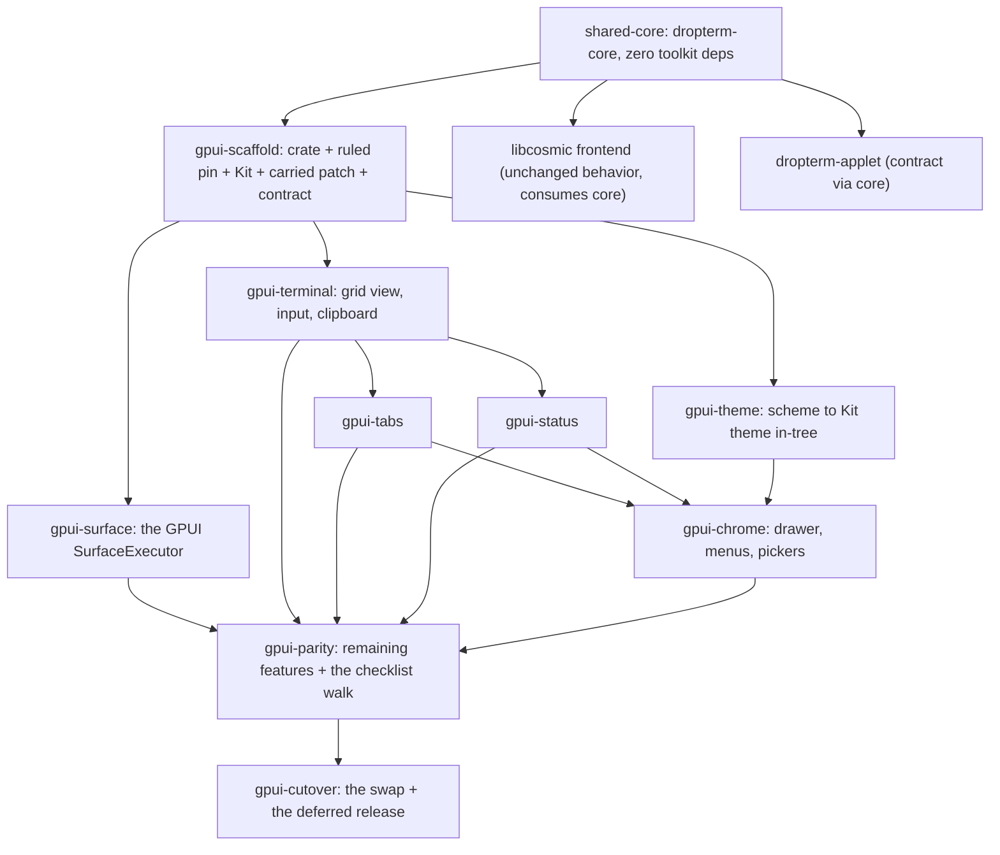

# Implementation Plan: the portability initiative

The plan-of-record is the committed
[portability plan](../docs/research/portability-plan.md) — this file is
its working breakdown: what `/build` consumes, per module, from the
chunks in this directory. Written by `/planning` 2026-11-10 over the
eleven approved specs; extended 2026-11-13 for Phase 3 (ids and specs
assigned per the spike-report checkpoint, on the GO + Kit-GO verdicts and
rulings items 7–8). The chunks are the only source of tasks.

## Overview

Phase 0 (hardware reality check) and Phase 2 (the GPUI spike) run from
day one beside Phase 1's three lanes: the flag-day rename
(`app-identity`), lane B's config-and-transport pair, lane A's surface
vocabulary, and lane C's small packages. Phase 1 pays off even if the
spike NO-GOs. Phase 3 is the GPUI rewrite: ten modules on main —
`shared-core` extracts the toolkit-free crate both frontends share, then
`gpui-scaffold` pins the ruled gpui-pre set with the Kit and its carried
border patch, and the rest build the GPUI drawer slice by slice to
parity, cutover, and the deferred release.

## Architecture decisions

Everything decided in the plan record and the specs stands; the
decisions below were made at `/planning` (each is also recorded in its
chunk; veto any at review):

1. **control-transport forwards through the activation shape, not V1
   members** — verified against `src/dbus_state.rs`: the V1 interface
   has no methods, only the `Visible`/`TabCount` properties; there is
   nothing to forward through, and adding a member is the
   contract-surface change the spec rules out. DropTerm serves
   `org.freedesktop.DbusActivation` at the object path over zbus
   itself.
2. **config-store writes one file per writer-section**
   (`config.ron`, `profiles.ron`, `keybinds.ron`) — cosmic-config's
   per-key files meant drawer writes never collided with external
   edits; per-section keeps that property with zero merge machinery
   (last-writer-wins within a file is the whole rule).
3. **The config directory derives from `APP_ID`**, overriding the
   spec's `$XDG_CONFIG_HOME/dropterm/` proposal — a hand-picked short
   name breaks the dev-identity separation the store must keep; the
   `session.rs` derivation pattern gives the `.Dev` twin its own files
   automatically.
4. **surface-intents' vocabulary is one enum** of declarative
   desired-state intents carrying a DropTerm surface handle; the
   recording executor lands with the trait (design rule 5); no
   `dropterm-platform` crate, no GPUI-shaped abstraction.
5. **Docs pages:** `docs/summon.md` (per-desktop summon bindings) and
   `docs/dbus.md` (the V1 contract). The contract page gets a pinning
   test in the `every_config_key_is_documented` style — it is cheap:
   serve V1 over the existing p2p harness, `Introspect`, assert every
   member appears on the page.

## Dependency graph

```
reality-check (hardware, no deps)          gpui-spike (hardware, no deps)
        │                                          │
        ├─ feeds layer-shell-guard (GNOME mode)    ├─ feeds Phase 3 ids
        ├─ feeds keybind-docs (verified rows)      └─ kit-pass (Kit ruled adopt)
        └─ feeds distro-reach (session-6 facts)

app-identity ──merges first──┬─ config-store ──── control-transport ── contract-docs
   (flag day, worktree A)    ├─ surface-intents (lane A)                 └─ layer-shell-guard rebase
  every package rebases      ├─ layer-shell-guard (lane C, small, first on main.rs)
  onto it                    ├─ keybind-docs (+ reality-check rows)
                            └─ distro-reach (+ reality-check session 6, rulings)
app-identity + config-store ship as one release (no break note —
pre-distribution, owner ruling 2026-11-12)
```

### Phase 3 dependency graph



Parallel after `gpui-scaffold`: `gpui-surface` ∥ `gpui-terminal` ∥
`gpui-theme`; then `gpui-tabs` ∥ `gpui-status`. The worktrees `../ced`
and `../ced2` host the parallel branches as in Phase 1; the sequential
spine (`shared-core`, `gpui-scaffold`, the closers) runs on main.

## Task list (index into the chunks)

### Phase 0 — hardware, no code ([reality-check](reality-check.md))
- [x] Tasks 1–7: the seven sessions, one slot each in the plan record
      *(rc-1/2/6/7 ran and their slots are filled; 2b/Hyprland, 3/KDE,
      and 4/GNOME waived — owner ruling 2026-11-15 closing Phase 0 with
      the sessions unrun; the plan record's slots carry the ruling)*
- [x] Task 8: close-out — every failure filed *(closed with the phase by
      the same ruling: the waived sessions filed nothing; the filled
      slots' failures are named, the no-layer-shell class carried the
      layer-shell-guard fix)*

### Phase 1 — flag day ([app-identity](app-identity.md))
- [ ] Task 1: the three owner rulings
- [ ] Tasks 2–4: code, packaging/CI, docs/release-skill sweeps
- [ ] Task 5: the rg audit
- [ ] Task 6: manual verification and merge
- **Checkpoint: after app-identity** — `just check`/CI green, installed
  build toggles under the new name, applet follows

### Phase 1 — lane B ([config-store](config-store.md), then [control-transport](control-transport.md))
- [x] config-store Tasks 1–5: store module → model off the derive →
      wire the app → reload (ask-first gate) → cosmic-config leaves
      *(merged f5199ec)*
- [ ] config-store Task 6 (hardware-gated): the dbus-config decision
      *(decision recorded; theme-follow manual row pending)*
- [x] control-transport Tasks 1–4: bus-name ownership → forwarding →
      contract pin → feature drop + applet canary *(merged e6ad23b;
      ship review findings landed as c5de59a before the merge)*
      *(T1–T3 done on `port/control-transport` — e16a976, c7e2a4f,
      616cba1; T4 pending)*
- **Checkpoint: the one release** — both packages merged, one release;
  no break note (owner ruling 2026-11-12: pre-distribution, no users).
  *Deferred 2026-11-12 (owner): the
  release is not cut yet — building continues; the release, when cut,
  carries everything merged by then (plan record, Release boundaries)*

### Phase 1 — lane A ([surface-intents](surface-intents.md))
- [ ] Tasks 1–5: vocabulary + recording executor → libcosmic executor
      pinned → decision layer migrates → handlers + full-lifecycle test
      → no-behavior-change verification
- **Checkpoint: the lifecycle is headless** — the property that makes a
  spike REDESIGN survivable

### Phase 1 — lane C ([layer-shell-guard](layer-shell-guard.md),
[keybind-docs](keybind-docs.md), [contract-docs](contract-docs.md),
[distro-reach](distro-reach.md))
- [ ] layer-shell-guard Tasks 1–3 (land before control-transport on
      `src/main.rs`, or rebase after)
- [ ] keybind-docs Task 1 (after reality-check rows + app-identity)
- [x] contract-docs Tasks 1–3 (after control-transport) *(merged
      5bf146b; ship fan-out findings landed first as 3e4783c)*
- [ ] distro-reach Tasks 1–5 (rulings first; 3–4 contingent)
- **Checkpoint: end of Phase 1** — the plan's exit: `just check` green,
  surface lifecycle headless end to end, `single-instance` and
  `cosmic-config` gone from the terminal crate, the release cut,
  Phase 0 slots filled

### Phase 2 — the spike ([gpui-spike](gpui-spike.md), [kit-pass](kit-pass.md))
- [ ] gpui-spike Tasks 1–9: scaffold → check 0 → lifecycle 1–8/2b →
      detection → grid → D-Bus → X11/macOS → coexistence → the report
- [ ] kit-pass Tasks 0–5 (only if the Kit is ruled adopt after the
      spike): gate → C1 re-run → C2a → C2b → C4 → verdict
- **Checkpoint: the spike report** — owner rules on the Kit (if not
  yet) and live geometry edits; Phase 3 slices get ids and specs.
  *(Held 2026-11-13: GO + Kit GO; the ids and specs exist — Phase 3
  below.)*

### Phase 3 — the GPUI rewrite (ids from the spike report; main lane)
- [x] [shared-core](shared-core.md) Tasks 1–5: crate + pure movers →
      split movers → identity/contract + applet re-point → decision
      layer + transport → no-behavior-change walk + merge
      *(merged 0db7f38, 2026-11-13 — the walk green on the validation
      VM, evidence in the lane's `target/vm-evidence-sc5/`)*
- **Checkpoint: the core stands alone** — zero toolkit deps pinned by
  test; libcosmic binary and applet identical *(held at the merge)*
- [x] [gpui-scaffold](gpui-scaffold.md) Tasks 1–4: crate + the ruled pin
      → Kit + `carried/gpui-component` + dev docs → startup dispatch →
      contract beside the loop + CLI parity
      *(merged 1a25154, 2026-11-13 — every task walked on the sway rig
      and the validation VM under snapshot discipline, evidence under
      `target/` (rig-evidence-sf{1,2,3,4}*, vm-evidence-sf{1,2,4}*,
      weston-evidence-sf3*); the walk also found and fixed a latent
      hole in core's transport: zbus 5 has no default method timeout,
      so a wedged owner hung every second launch — the forward is now
      bounded at 5 s for both frontends)*
- **Checkpoint: the frontend exists** — pinned, patched, boots on both
  compositors, owns the name *(held at the merge)*
- [x] [gpui-surface](gpui-surface.md) Tasks 1–4: executor + two-surface
      show → cadence resize + recreate edit → holds + slide +
      focus-loss → budget + rows + merge
      *(merged 05ac2ba, 2026-11-13 — every task walked on the sway rig
      and the validation VM under snapshot discipline, evidence under
      `target/` (rig-evidence-gs{1,2,3}*, vm-evidence-gs{1,2,3,4}*);
      dropterm-core untouched (empty diff, 819 tests green); seven
      structural findings banked from the walks, the load-bearing one
      being the lifetime rule: GPUI's default quit mode quits on
      last-window-close, fatal for a hidden-boot single instance —
      the binary runs QuitMode::Explicit; the mid-slide reversal is
      wire-evidenced on the rig and rides parity's human-at-console
      row on the VM, as si-5 parked it for the libcosmic build)*
- [x] [gpui-terminal](gpui-terminal.md) Tasks 1–4: grid view + resize →
      input/keybinds/selection/scrollback → mouse + clipboard →
      integration + merge
      *(merged 761547d, 2026-11-14 — every task walked on the sway rig
      and the validation VM under snapshot discipline, evidence under
      `target/` (rig-evidence-gt{1,2,4}*, vm-evidence-gt{1,2,3,4}*);
      core grew the framework-free mouse-tracking encodings (both
      frontends consume one implementation now, the libcosmic
      frontend an adapter with its 702 tests unchanged); structural
      findings banked from the walks: the silent unheld-font
      rasterization (candidate-list resolution), the rig's
      never-presenting harness surface (keyboard reaches it, pixels
      and pointer never — the drawer's own window presents), and the
      environment classes (cosmic-comp drops wtype's modifiers;
      uinput wheel synthesis reaches no app on the VM — the
      physical-wheel row rides parity's human-at-console class); the
      drawer is a terminal end to end: toggle → slide → live pane,
      typed, selected, scrolled, copied, hidden by the pane's own
      chord, re-shown — first frames 35–54 ms inside the 130 ms
      budget on both compositors)*
- [x] [gpui-theme](gpui-theme.md) Tasks 1–2: carry the generator → the
      apply path (first frame + live) *(merged 36648c1, 2026-11-14:
      the C4 generator carried byte-identical from the spike (cd06740
      + the SPDX header, diff-checked) with its four tests and the
      pedantic adaptation on main.rs's mod declaration, and the apply
      path walked green on rig + VM — the scheme applies in boot()
      before any window exists (tokens reading back Dracula
      background l=0.184 = #282A36, primary riding its Blue), a live
      Dracula→Nord edit re-themes without restart with the drawer
      band's pixels following on both compositors (40,42,54 →
      46,52,64 = #2E3440), a geometry-only edit reshapes without
      re-theming (the identity detector, pinned by unit test too),
      the pane re-themes on the same resolution (the resolve/
      boot_colors one-chain agreement pinned field-wise), and the
      kill check now themes through the same route with its flush
      edges intact — the standing C4 chrome harness; 77 crate tests,
      just check green on the merge result; evidence under the lane's
      target/{rig,vm}-evidence-gm2-*)*
- **Checkpoint: a working, themed terminal drawer on GPUI**
      (surface ∥ terminal ∥ theme after scaffold) — **held
      2026-11-14**: all three parallel slices merged (05ac2ba ·
      761547d · 36648c1); the drawer is a working, themed terminal on
      GPUI; next: `gpui-tabs` ∥ `gpui-status`
- [ ] [gpui-tabs](gpui-tabs.md) Tasks 1–3 · [gpui-status](gpui-status.md)
      Tasks 1–3 (parallel after terminal)
- [ ] [gpui-chrome](gpui-chrome.md) Tasks 1–3: menus + pickers → the
      drawer → cadence row + merge
- **Checkpoint: full UI parity feature set**
- [ ] [gpui-parity](gpui-parity.md) Tasks 1–4: suggest → images → bell +
      session restore → the whole-checklist walk, both compositors
      *(gate: open question item 9 ruled)*
- **Checkpoint: parity — Phase 3's exit line**
- [ ] [gpui-cutover](gpui-cutover.md) Tasks 1–3: the swap (owner-gated)
      → docs true → the deferred release (owner fires `/release`)
- **Checkpoint: Phase 3 exits** — parity proven, one binary, the release
  cut; Phase 4 may open

## Parallelization

Safe to parallelize: the three Phase 1 lanes (separate worktrees, by
design); Phase 0 sessions (pre-made slots prevent line collisions); the
spike (own workspace, never shares `target/`). Phase 3: `gpui-surface` ∥
`gpui-terminal` ∥ `gpui-theme` after `gpui-scaffold` (the parallel
branches live in `../ced` and `../ced2`; each touches its own region of
the new crate, second merger rebases), then `gpui-tabs` ∥ `gpui-status`.
Must be sequential: lane B's own pair (`config-store` →
`control-transport`); every merge after `app-identity`; Phase 3's spine —
`shared-core` merges alone (it moves everything), then `gpui-scaffold`,
then the closers (`gpui-chrome` after its three feeders, `gpui-parity`
after everything, `gpui-cutover` last). Needs coordination: the root
`Cargo.toml`/lockfile between `gpui-scaffold` and any parallel slice that
adds dependencies; the `dropterm-gpui` crate's app-shell wiring between
the parallel UI slices (integration tasks land last in each chunk).

## Worktree seeding

Retired (owner ruling, 2026-11-12): the chunks and specs are committed,
so worktrees get the whole set through git — nothing to copy, nothing to
symlink. `tasks/gpui-portability-verification.md` is the research
evidence record, not a chunk.

## Risks and mitigations

| Risk | Impact | Mitigation |
|---|---|---|
| Phase 0 finds sway/Hyprland/KDE broken (kill-risk 1) | High | Sessions run first, before and beside the lanes; every failure becomes its own bug package, sizing Phase 1 before toolkit work |
| Spike check 3 fails with no redesign (kill-risk 2) | High | The report's verdict gates Phase 3; NO-GO falls back to `iced_layershell` or a fork per the plan; Phase 1 pays off regardless |
| app-identity rulings delayed | Medium | Task 1 is the gate; the sweep tasks cannot start without the literals — ask early |
| `src/app.rs` rebase conflicts between lanes A and B | Medium | Different regions by spec; second merger rebases; lanes are short-lived branches |
| The `notify` dependency declined | Low | Fallback is re-read-at-show (one manual checklist row); the store itself is unaffected |
| `shared-core`'s move regresses the shipped binary | High | The existing test set moves with the code and is the pin; the slice's last task is a no-behavior-change VM walk before merge; it merges alone, fresh off main |
| GPUI text rendering can't hold the terminal's perf (damage, scrollback) | Medium | Damage-first is ruled in the chunk; Zed's `crates/terminal` is the worked reference; the perf rows are explicit walk rows, and a miss is fixable inside the slice before parity |
| A Kit bump breaks the carried patch or the pin set | Medium | The manifest pin test fails `just check` on any drift; the comeback checklist (kit-root-border) re-runs the kill check on every bump; the pin is `=`, not `^` |
| Dock mode has no GPUI answer by parity time | Medium | Open question item 9 rules it before the parity walk reaches those rows; the config surface keeps parsing either way, so the degradation is behavioral only |
| The parity walk finds a row GPUI cannot express | Medium | The chunk's rule: the row stops the task and files an owner ruling — deviation is a decision, never a silent skip |

## Open questions (owner rulings outstanding)

1. **app-identity's three rulings** (chunk Task 1) — DECIDED
   2026-11-10: app id `io.github.l1br3_io.dropterm`; applet binary
   `dropterm-applet`, desktop id `io.github.l1br3_io.dropterm.Applet`;
   repo rename now (the sweep writes the new URLs, org `l1br3-io` repo
   `dropterm`; the act stays the owner's).
2. **config-store's watcher dependency** (chunk Task 4's gate) —
   DECIDED 2026-11-10: `notify` sanctioned.
3. **The Kit ruling** (open ruling 1; recommended after the spike
   reads the ledger) and its timing (open ruling 2). — DECIDED
   2026-11-13: adopt, ruled at open ruling 2's recommended timing at
   the `/build auto` gate (recorded at kp-0 and the plan record's
   Phase 2 results).
4. **Live geometry edits under GPUI** (open ruling 3): answered by the
   spike's check 2b recreate-cost measurement.
5. **config-store's dbus-config feature** (chunk Task 6): decided on
   COSMIC hardware, not at a desk. — DECIDED 2026-11-11: dropped
   (576d3bc), theme follow verified live on the fallback watcher.
6. **distro-reach's two rulings** (chunk Task 2): the glibc floor and
   the native channels — the chunk is a shell until they land, as its
   spec is. — PARKED 2026-11-13 (owner): deferred with the release.
7. **The Kit auto-border debt** (the Kit GO's one carried debt; the
   record's "Phase 3's first Kit decision"): DECIDED 2026-11-13 — the
   one-const carried patch wins: a private source copy under
   `[patch]`, never a public fork, with an upstream opt-out ask as the
   retirement path; the drawer stays edge-to-edge. The carried-patch
   ledger takes its third entry when Phase 3 lands the copy, and the
   dev docs (a carried-patches section in development.md) ship with
   that module, not before — the docs-to-code gates forbid describing
   code that does not exist yet. Durable record:
   docs/research/kit-root-border.md — this spec/task set archives
   after the initiative; that record is the comeback copy. The pin
   half: item 8.
8. **Phase 3's pin** (the decision the Kit verdict armed): DECIDED
   2026-11-13, on the recommendation after kp-1's fidelity proof —
   the snapshot is the GPUI source: Phase 3 builds on the published
   gpui-pre =0.3.12 set, never a zed git pin (the standing "the
   snapshot replaces the git pin" rule), and the Kit
   (gpui-component =0.9.1, component-only) rides the same pin.
9. **Dock mode under GPUI** (surfaced at `/planning` 2026-11-13):
   `show_in_dock` buys its dock/switcher presence from the clipboard
   anchor — a persistent toplevel — and check 8 killed the anchor on
   GPUI (the gate is focus+serial; the terminal satisfies it by
   construction). The manual checklist's shell-presence rows force a
   choice before `gpui-parity`'s walk reaches them: replicate the
   presence with a persistent toplevel on the GPUI side, or accept a
   degradation (dock mode rides hidden-mode behavior) and amend the
   rows. The config key keeps parsing either way. Default
   recommendation: replicate — the feature is behavior parity, and a
   hidden toplevel is cheap; the ruling is the owner's. — DECIDED
   2026-11-15 (owner, at the py-4 gate): replicate. The GPUI side
   carries a mapped 1×1 toplevel (undecorated, immovable,
   never-steals-focus, the app id, the libcosmic dock body's own
   shape) opened at boot and swapped live at every config echo while
   `show_in_dock` holds; the hidden mode needs no body — the drawer's
   layer surfaces are invisible to the toplevel listings by protocol,
   and GPUI's clipboard needs no anchor (check 8's ruling: unfocused
   copies ride data-control).

## Phase 3 planning rulings (made at /planning 2026-11-13; veto at
review)

Each is also recorded in its chunk:

1. **The shared crate is `dropterm-core`**, a path member of the root
   workspace (one lockfile — check 14's absorption), and the decision
   layer moves with it ("the state machine survives; only its executors
   change" — a state machine left libcosmic-side is duplication, not
   sharing). Engine-side cosmic-text buffers stay with the widget
   (check 9's boundary).
2. **The Phase 3 bin is `dropterm-gpui`**; cutover renames it to
   `dropterm` and deletes the libcosmic frontend outright (history
   keeps it; a parked second frontend is unsanctioned debt).
3. **The carried Kit copy lives at `carried/gpui-component/`** under
   `[patch.crates-io]` (the `vendor/` name is the release recipe's),
   with a manifest pin test so any drift fails `just check`.
4. **The surface executor's reconcile split is resize-vs-recreate**
   (cadence resize in place, anchor/margin edits recreate — open
   ruling 3's numbers), and `Hold { Released }` may ride a recreate at
   this pin, cost inside the slide budget.
5. **Dock mode is an owner question** (open questions item 9), ruled
   before the parity walk reaches the shell-presence rows.

## Hardening pass (opened 2026-11-16): toggle-ram → resource-audit

The owner reported repeated toggling eating RAM until the app
crashes; the pass fixes that and then sweeps every other
crash/resource-exhaustion vector. Specs: [SPEC-toggle-ram.md](../SPEC-toggle-ram.md),
[SPEC-resource-audit.md](../SPEC-resource-audit.md); chunks:
[toggle-ram.md](toggle-ram.md), [resource-audit.md](resource-audit.md)
(the chunks are the task detail; this section is the aggregate view).

### Planning rulings (made at /planning 2026-11-16; veto at review)

1. **Measure-first is mandatory.** No fix lands without an attributed
   vector (mapping + code path) and before/after numbers — 74e6d85's
   discipline, extended past `[heap]`.
2. **Both regimes are first-class.** Paced (1 s settle, the only
   regime ever measured) and spam (100 ms and 50 ms profiles, under
   the 150 ms debounce and inside the ~130 ms slide — never probed).
3. **VM probe stays owner-run by default** (2026-11-14 ruling). The
   standing-exception ask rides tr-1's review; 74e6d85's one-off is
   the precedent. Agent-run evidence, if sanctioned, is marked
   agent-run.
4. **The audit's dispositions are three**: fixed with a stated bound
   (a number in a test or docs row) and a pin, filed in known-issues
   with evidence, or deferred by owner ruling. The report
   (`docs/research/resource-audit.md`) is an immutable research
   record once filed.
5. **Debug instrumentation is itself in scope**: the toggle-dump
   trace's append-only `/tmp` log gets bounded or gated (ra-1's cheap
   fix).

### Task index

- tr-1 the attribution probe (both regimes, per mapping, fd/thread,
  build identity) → tr-2 the fix (gated on attribution) → tr-3 bank
  it (evidence + docs rows). Checkpoint: flat tail, crash gone.
- ra-1 descriptors/processes/threads/disk → ra-2 memory/GPU →
  ra-3 concurrency/panics/input bombs (ra-1..3 may interleave; all
  need tr-1's tooling) → ra-4 the P1 fix batch (gated on findings) →
  ra-5 the report filed. Checkpoint: every vector dispositioned.

### Risks and mitigations

| Risk | Impact | Mitigation |
|---|---|---|
| Root cause is upstream (GPUI/wgpu, cosmic-comp) | High | File with evidence; smallest carried remedy, ask-first (kit-root-border precedent) |
| VM cannot reproduce the crash (hardware-only) | Med | tr-1's owner-run signature capture; hardware rows stay owner's |
| Spam regime surfaces several interacting causes | Med | Triage by mapping size; one cause per commit, numbers each |
| Findings grow past the chunk's shape | Low | Split tasks rather than grow them (house ≤5-file rule) |

### Open questions

1. Which build crashed (with or without 74e6d85) — tr-1 answers by
   construction (build identity in every probe run).
2. The crash's shape (OOM, panic, hang, session-level) — tr-1's
   owner-run capture.
3. The standing VM-probe exception — asked at tr-1's review.

## RAM initiative (opened 2026-11-17): ram-leak → ram-telemetry

The kernel OOM-killed this repo's own lib-test binary on 2026-11-17
20:54 — 47.1 GB anon-rss in a ~12 s run of the real-rc resize-churn
probe (`dropterm-59e80177bea39695`), the app's exact toggle path —
and the owner confirms daily-use RAM growth. The initiative fixes
the bomb, then ships the always-on sampler that makes daily growth
observable as data. Specs: [SPEC-ram-leak.md](../SPEC-ram-leak.md),
[SPEC-ram-telemetry.md](../SPEC-ram-telemetry.md); chunks:
[ram-leak.md](ram-leak.md), [ram-telemetry.md](ram-telemetry.md)
(the chunks are the task detail; this section is the aggregate
view). Tooling grounding:
[docs/research/memory-tracking-tooling.md](../docs/research/memory-tracking-tooling.md).

### Planning rulings (made at /planning 2026-11-17; veto at review)

1. **Every reproduction is capped, every time** —
   `systemd-run --user --scope -p MemoryMax=2G -p MemoryHigh=1536M
   -p MemorySwapMax=0`; the High-before-Max ordering is what lets
   heaptrack's exit-time dump finalize, and the cap value is
   recorded per run (owner sanction 2026-11-17: agent-run headless
   reproductions allowed under exactly this shape).
2. **Instruments, fixed**: heaptrack primary; dhat mid-run
   `HeapStats` the fallback when the kill is the point (exit-time
   dumps die with SIGKILL, stderr survives); massif only if
   heaptrack is unavailable; bytehound reserved for fragmentation
   questions.
3. **The real-rc reproduction is `#[ignore]`-gated** — a real login
   rc is environment-dependent, so `just check` stays deterministic
   and runs none of it; the CI-load pin is synthetic once rl-2
   names the mechanism.
4. **The sampler is std-only**; `procfs = 0.18` is the ask-first
   typed fallback; `memory-stats` and `sysinfo` are rejected on the
   tooling record's verdicts.
5. **Sampler rows are self-describing plain text with children
   columns fed from tracked pids** (the owner's 2026-11-17
   AI-extractability ruling): an agent extracts the log with std
   tooling, no parsing preamble; child-driven growth shows in the
   log itself.
6. **Fork fixes ride kit-root-border**: the patch carried at the
   pin plus an upstream ask; a re-pin is ask-first, never silent.
7. **Evidence recording**: agent-run capped evidence is marked
   agent-run (the 2026-11-17 sanction); GUI rows stay owner-run
   (the 2026-11-14 ruling).

### Task index

- rl-1 the capped reproduction (`#[ignore]` test, curve recorded,
  the probe's panic-shape gone) → rl-2 attribution (heaptrack/dhat,
  the stack + GB/s arithmetic + fix-site verdict) → rl-3 the fix +
  synthetic pin *(gated on attribution; fork path ask-first)* →
  rl-4 the incident record. Checkpoint: capped repro flat, owner
  has the numbers.
- rt-1 the sampler module (parse/rotate/failure-safe, unit-pinned,
  zero deps) → rt-2 the 1 Hz tick hook + children feed + capped
  smoke (the owner's daily-session instruction issued) → rt-3 docs
  (schema, extraction one-liners, capture ladder). Checkpoint: the
  watch live; the owner's daily-session verdict closes it.

### Risks and mitigations

| Risk | Impact | Mitigation |
|---|---|---|
| heaptrack's dump dies with the process under the cap | Med | High-before-Max ordering + deadline-bounded churn; dhat mid-run stderr the fallback |
| The root cause lands in the pinned fork | High | kit-root-border shape: carried patch + upstream ask, re-pin ask-first (ruling 6) |
| The mechanism resists a synthetic pin | Med | The real-rc test stays `#[ignore]`-gated and rides rl-3's rerun; the pin can assert the mechanism's unit if the full churn can't be headless |
| Daily growth survives the fix (a second vector) | Med | Expected and watched: ram-telemetry's curve is the detector; rl-4 records what the fix does not explain rather than hiding it |
| Dev-profile symbolization noise in heaptrack stacks | Low | The record's symbolization notes (dev build, or release with `debug = true`); rl-2 records which was used |

### Open questions

1. Whether the daily-use growth is the same vector as the bomb —
   answered by ram-telemetry's curve post-fix (rl-4 states the
   expectation honestly either way).
2. heaptrack availability on the owner's machine (Pop!_OS:
   `apt install heaptrack`) — rl-2 answers by construction.

## Theming module (opened 2026-11-18): theme-defaults

First install today always opens COSMIC Dark — `System` is pinned
dark at all three resolve sites (the live watch deferred since
cutover), no OS accent is read, and no github scheme exists. The
module ships GitHub's Primer pair as the default schemes and makes
Follow system real through the portal color-scheme. Spec:
[SPEC-theme-defaults.md](../SPEC-theme-defaults.md); chunk:
[theme-defaults.md](theme-defaults.md) (the chunk is the task
detail; this section is the aggregate view).

### Planning rulings (made at /planning 2026-11-18; veto at review)

1. **Registry order keeps defaults-first**: GitHub Dark, GitHub
   Light at rows 0-1, the COSMIC pair at 2-3, the alphabetical rest
   after — the "first two are the defaults" convention survives with
   new names, and the dropdowns open on the real defaults. The
   hole-check test skips the background-less pair by name, not
   index.
2. **One default-pair source**: the name constants live in
   `theme_source.rs` (the schemes' definition site); config's
   `Default`, the registry rows, and `theme_glue`'s unknown-name
   fallback all reference them, and an agreement pin ties the three
   (today they are three independent definition sites — a constants
   flip alone would not move the fallback).
3. **The system mode travels through a process-global cell**
   (`core/system_mode.rs`, the engine-globals pattern): `AtomicBool`
   + revision, default dark — the fallback is also the pre-read
   state. The three literal-`true` sites read it, which also answers
   the pre-Shell fleet-boot ordering (no Shell field exists yet
   there).
4. **Boot is fallback-then-correct, never a block**: the watch
   spawns before the boot apply; the cell reads dark until the
   portal answers; the landed value bumps the revision and the
   pump's check feeds the same resolve → identity → `pending_theme`
   funnel config echoes use (one extracted helper, two callers). The
   app boots hidden, so the correction lands before a human ever
   sees a frame — the 130 ms OPEN→FIRST_FRAME budget is untouched.
5. **The watch owns its thread** — a std thread + current-thread
   tokio runtime, the `dbus.rs` spawn shape without coupling to the
   V1 server's lifecycle (whose loser arm parks forever). zbus 5.19
   is in-tree; no new dependencies.
6. **Accent anchors rule the transcription**: the entries' slots are
   chosen so the generated chrome accent lands on `#0969DA` /
   `#2F81F7`; any deviation from github-vscode-theme's table is
   cited in the spot-check test.

### Task index

- td-1 the GitHub pair ships as the default (entries + citations,
  defaults flip, fallback flip, the four hard pins, configuration.md
  rows) → td-2 Follow system reads the OS for real (`system_mode`
  cell + portal watch, the three sites wired, the funnel reuse,
  theming.md re-truthed, the owner's manual rows). Checkpoint: fresh
  install GitHub-themed following the OS, dark fallback on bare
  sway, docs true.

### Risks and mitigations

| Risk | Impact | Mitigation |
|---|---|---|
| A host's portal lacks the appearance key (backend-dependent) | Med | Error arm stays dark (today's behavior); td-2's owner walk verifies the chain on COSMIC; a cosmic-config reader is the ask-first fallback plan |
| Global cell races parallel tests | Med | Lock-guarded override seam (`with_system_mode`); tests restore state |
| SettingChanged fires for every namespace | Low | The watch filters to `org.freedesktop.appearance` / `color-scheme`; the mapping is unit-pinned |
| Test-pin churn exceeds the estimate (order/len/commit rows, `skip(2)`) | Low | All four named in td-1; mechanical |
| One-tick transient after a flip (render resolves the new mode before `apply_pending_theme` runs) | Low | The same ≤100 ms window config edits already have; no new mechanism |

### Open questions

1. Does the COSMIC portal backend serve the appearance color-scheme
   key and its `SettingChanged` signal — td-2's owner walk answers
   on the primary platform; if absent, the fallback is dark and the
   cosmic-config reader goes to ask-first.
2. Does github-vscode-theme's terminal palette cover both modes
   without gaps — td-1's transcription answers; derived slots must
   say so in the citation rather than inventing values.
