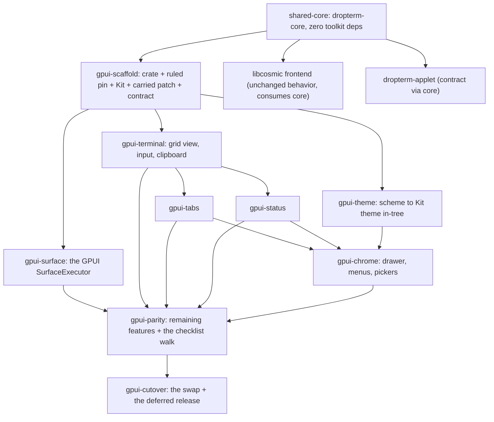

# Implementation Plan: the portability initiative

The plan-of-record is the committed
[portability plan](../docs/research/portability-plan.md) — this file is
its working breakdown: what `/build` consumes, per module, from the
chunks in this directory. Written by `/planning` 2026-11-10 over the
eleven approved specs; extended 2026-11-13 for Phase 3 (ids and specs
assigned per the spike-report checkpoint, on the GO + Kit-GO verdicts and
rulings items 7–8). The chunks are the only source of tasks.

## Overview

Phase 0 (hardware reality check) and Phase 2 (the GPUI spike) run from
day one beside Phase 1's three lanes: the flag-day rename
(`app-identity`), lane B's config-and-transport pair, lane A's surface
vocabulary, and lane C's small packages. Phase 1 pays off even if the
spike NO-GOs. Phase 3 is the GPUI rewrite: ten modules on main —
`shared-core` extracts the toolkit-free crate both frontends share, then
`gpui-scaffold` pins the ruled gpui-pre set with the Kit and its carried
border patch, and the rest build the GPUI drawer slice by slice to
parity, cutover, and the deferred release.

## Architecture decisions

Everything decided in the plan record and the specs stands; the
decisions below were made at `/planning` (each is also recorded in its
chunk; veto any at review):

1. **control-transport forwards through the activation shape, not V1
   members** — verified against `src/dbus_state.rs`: the V1 interface
   has no methods, only the `Visible`/`TabCount` properties; there is
   nothing to forward through, and adding a member is the
   contract-surface change the spec rules out. DropTerm serves
   `org.freedesktop.DbusActivation` at the object path over zbus
   itself.
2. **config-store writes one file per writer-section**
   (`config.ron`, `profiles.ron`, `keybinds.ron`) — cosmic-config's
   per-key files meant drawer writes never collided with external
   edits; per-section keeps that property with zero merge machinery
   (last-writer-wins within a file is the whole rule).
3. **The config directory derives from `APP_ID`**, overriding the
   spec's `$XDG_CONFIG_HOME/dropterm/` proposal — a hand-picked short
   name breaks the dev-identity separation the store must keep; the
   `session.rs` derivation pattern gives the `.Dev` twin its own files
   automatically.
4. **surface-intents' vocabulary is one enum** of declarative
   desired-state intents carrying a DropTerm surface handle; the
   recording executor lands with the trait (design rule 5); no
   `dropterm-platform` crate, no GPUI-shaped abstraction.
5. **Docs pages:** `docs/summon.md` (per-desktop summon bindings) and
   `docs/dbus.md` (the V1 contract). The contract page gets a pinning
   test in the `every_config_key_is_documented` style — it is cheap:
   serve V1 over the existing p2p harness, `Introspect`, assert every
   member appears on the page.

## Dependency graph

```
reality-check (hardware, no deps)          gpui-spike (hardware, no deps)
        │                                          │
        ├─ feeds layer-shell-guard (GNOME mode)    ├─ feeds Phase 3 ids
        ├─ feeds keybind-docs (verified rows)      └─ kit-pass (Kit ruled adopt)
        └─ feeds distro-reach (session-6 facts)

app-identity ──merges first──┬─ config-store ──── control-transport ── contract-docs
   (flag day, worktree A)    ├─ surface-intents (lane A)                 └─ layer-shell-guard rebase
  every package rebases      ├─ layer-shell-guard (lane C, small, first on main.rs)
  onto it                    ├─ keybind-docs (+ reality-check rows)
                            └─ distro-reach (+ reality-check session 6, rulings)
app-identity + config-store ship as one release (no break note —
pre-distribution, owner ruling 2026-11-12)
```

### Phase 3 dependency graph



Parallel after `gpui-scaffold`: `gpui-surface` ∥ `gpui-terminal` ∥
`gpui-theme`; then `gpui-tabs` ∥ `gpui-status`. The worktrees `../ced`
and `../ced2` host the parallel branches as in Phase 1; the sequential
spine (`shared-core`, `gpui-scaffold`, the closers) runs on main.

## Task list (index into the chunks)

### Phase 0 — hardware, no code ([reality-check](reality-check.md))
- [ ] Tasks 1–7: the seven sessions, one slot each in the plan record
- [ ] Task 8: close-out — every failure filed

### Phase 1 — flag day ([app-identity](app-identity.md))
- [ ] Task 1: the three owner rulings
- [ ] Tasks 2–4: code, packaging/CI, docs/release-skill sweeps
- [ ] Task 5: the rg audit
- [ ] Task 6: manual verification and merge
- **Checkpoint: after app-identity** — `just check`/CI green, installed
  build toggles under the new name, applet follows

### Phase 1 — lane B ([config-store](config-store.md), then [control-transport](control-transport.md))
- [x] config-store Tasks 1–5: store module → model off the derive →
      wire the app → reload (ask-first gate) → cosmic-config leaves
      *(merged f5199ec)*
- [ ] config-store Task 6 (hardware-gated): the dbus-config decision
      *(decision recorded; theme-follow manual row pending)*
- [x] control-transport Tasks 1–4: bus-name ownership → forwarding →
      contract pin → feature drop + applet canary *(merged e6ad23b;
      ship review findings landed as c5de59a before the merge)*
      *(T1–T3 done on `port/control-transport` — e16a976, c7e2a4f,
      616cba1; T4 pending)*
- **Checkpoint: the one release** — both packages merged, one release;
  no break note (owner ruling 2026-11-12: pre-distribution, no users).
  *Deferred 2026-11-12 (owner): the
  release is not cut yet — building continues; the release, when cut,
  carries everything merged by then (plan record, Release boundaries)*

### Phase 1 — lane A ([surface-intents](surface-intents.md))
- [ ] Tasks 1–5: vocabulary + recording executor → libcosmic executor
      pinned → decision layer migrates → handlers + full-lifecycle test
      → no-behavior-change verification
- **Checkpoint: the lifecycle is headless** — the property that makes a
  spike REDESIGN survivable

### Phase 1 — lane C ([layer-shell-guard](layer-shell-guard.md),
[keybind-docs](keybind-docs.md), [contract-docs](contract-docs.md),
[distro-reach](distro-reach.md))
- [ ] layer-shell-guard Tasks 1–3 (land before control-transport on
      `src/main.rs`, or rebase after)
- [ ] keybind-docs Task 1 (after reality-check rows + app-identity)
- [x] contract-docs Tasks 1–3 (after control-transport) *(merged
      5bf146b; ship fan-out findings landed first as 3e4783c)*
- [ ] distro-reach Tasks 1–5 (rulings first; 3–4 contingent)
- **Checkpoint: end of Phase 1** — the plan's exit: `just check` green,
  surface lifecycle headless end to end, `single-instance` and
  `cosmic-config` gone from the terminal crate, the release cut,
  Phase 0 slots filled

### Phase 2 — the spike ([gpui-spike](gpui-spike.md), [kit-pass](kit-pass.md))
- [ ] gpui-spike Tasks 1–9: scaffold → check 0 → lifecycle 1–8/2b →
      detection → grid → D-Bus → X11/macOS → coexistence → the report
- [ ] kit-pass Tasks 0–5 (only if the Kit is ruled adopt after the
      spike): gate → C1 re-run → C2a → C2b → C4 → verdict
- **Checkpoint: the spike report** — owner rules on the Kit (if not
  yet) and live geometry edits; Phase 3 slices get ids and specs.
  *(Held 2026-11-13: GO + Kit GO; the ids and specs exist — Phase 3
  below.)*

### Phase 3 — the GPUI rewrite (ids from the spike report; main lane)
- [ ] [shared-core](shared-core.md) Tasks 1–5: crate + pure movers →
      split movers → identity/contract + applet re-point → decision
      layer + transport → no-behavior-change walk + merge
- **Checkpoint: the core stands alone** — zero toolkit deps pinned by
  test; libcosmic binary and applet identical
- [ ] [gpui-scaffold](gpui-scaffold.md) Tasks 1–4: crate + the ruled pin
      → Kit + `carried/gpui-component` + dev docs → startup dispatch →
      contract beside the loop + CLI parity
- **Checkpoint: the frontend exists** — pinned, patched, boots on both
  compositors, owns the name
- [ ] [gpui-surface](gpui-surface.md) Tasks 1–4: executor + two-surface
      show → cadence resize + recreate edit → holds + slide +
      focus-loss → budget + rows + merge
- [ ] [gpui-terminal](gpui-terminal.md) Tasks 1–4: grid view + resize →
      input/keybinds/selection/scrollback → mouse + clipboard →
      integration + merge
- [ ] [gpui-theme](gpui-theme.md) Tasks 1–2: carry the generator → the
      apply path (first frame + live)
- **Checkpoint: a working, themed terminal drawer on GPUI**
      (surface ∥ terminal ∥ theme after scaffold)
- [ ] [gpui-tabs](gpui-tabs.md) Tasks 1–3 · [gpui-status](gpui-status.md)
      Tasks 1–3 (parallel after terminal)
- [ ] [gpui-chrome](gpui-chrome.md) Tasks 1–3: menus + pickers → the
      drawer → cadence row + merge
- **Checkpoint: full UI parity feature set**
- [ ] [gpui-parity](gpui-parity.md) Tasks 1–4: suggest → images → bell +
      session restore → the whole-checklist walk, both compositors
      *(gate: open question item 9 ruled)*
- **Checkpoint: parity — Phase 3's exit line**
- [ ] [gpui-cutover](gpui-cutover.md) Tasks 1–3: the swap (owner-gated)
      → docs true → the deferred release (owner fires `/release`)
- **Checkpoint: Phase 3 exits** — parity proven, one binary, the release
  cut; Phase 4 may open

## Parallelization

Safe to parallelize: the three Phase 1 lanes (separate worktrees, by
design); Phase 0 sessions (pre-made slots prevent line collisions); the
spike (own workspace, never shares `target/`). Phase 3: `gpui-surface` ∥
`gpui-terminal` ∥ `gpui-theme` after `gpui-scaffold` (the parallel
branches live in `../ced` and `../ced2`; each touches its own region of
the new crate, second merger rebases), then `gpui-tabs` ∥ `gpui-status`.
Must be sequential: lane B's own pair (`config-store` →
`control-transport`); every merge after `app-identity`; Phase 3's spine —
`shared-core` merges alone (it moves everything), then `gpui-scaffold`,
then the closers (`gpui-chrome` after its three feeders, `gpui-parity`
after everything, `gpui-cutover` last). Needs coordination: the root
`Cargo.toml`/lockfile between `gpui-scaffold` and any parallel slice that
adds dependencies; the `dropterm-gpui` crate's app-shell wiring between
the parallel UI slices (integration tasks land last in each chunk).

## Worktree seeding

Retired (owner ruling, 2026-11-12): the chunks and specs are committed,
so worktrees get the whole set through git — nothing to copy, nothing to
symlink. `tasks/gpui-portability-verification.md` is the research
evidence record, not a chunk.

## Risks and mitigations

| Risk | Impact | Mitigation |
|---|---|---|
| Phase 0 finds sway/Hyprland/KDE broken (kill-risk 1) | High | Sessions run first, before and beside the lanes; every failure becomes its own bug package, sizing Phase 1 before toolkit work |
| Spike check 3 fails with no redesign (kill-risk 2) | High | The report's verdict gates Phase 3; NO-GO falls back to `iced_layershell` or a fork per the plan; Phase 1 pays off regardless |
| app-identity rulings delayed | Medium | Task 1 is the gate; the sweep tasks cannot start without the literals — ask early |
| `src/app.rs` rebase conflicts between lanes A and B | Medium | Different regions by spec; second merger rebases; lanes are short-lived branches |
| The `notify` dependency declined | Low | Fallback is re-read-at-show (one manual checklist row); the store itself is unaffected |
| `shared-core`'s move regresses the shipped binary | High | The existing test set moves with the code and is the pin; the slice's last task is a no-behavior-change VM walk before merge; it merges alone, fresh off main |
| GPUI text rendering can't hold the terminal's perf (damage, scrollback) | Medium | Damage-first is ruled in the chunk; Zed's `crates/terminal` is the worked reference; the perf rows are explicit walk rows, and a miss is fixable inside the slice before parity |
| A Kit bump breaks the carried patch or the pin set | Medium | The manifest pin test fails `just check` on any drift; the comeback checklist (kit-root-border) re-runs the kill check on every bump; the pin is `=`, not `^` |
| Dock mode has no GPUI answer by parity time | Medium | Open question item 9 rules it before the parity walk reaches those rows; the config surface keeps parsing either way, so the degradation is behavioral only |
| The parity walk finds a row GPUI cannot express | Medium | The chunk's rule: the row stops the task and files an owner ruling — deviation is a decision, never a silent skip |

## Open questions (owner rulings outstanding)

1. **app-identity's three rulings** (chunk Task 1) — DECIDED
   2026-11-10: app id `io.github.l1br3_io.dropterm`; applet binary
   `dropterm-applet`, desktop id `io.github.l1br3_io.dropterm.Applet`;
   repo rename now (the sweep writes the new URLs, org `l1br3-io` repo
   `dropterm`; the act stays the owner's).
2. **config-store's watcher dependency** (chunk Task 4's gate) —
   DECIDED 2026-11-10: `notify` sanctioned.
3. **The Kit ruling** (open ruling 1; recommended after the spike
   reads the ledger) and its timing (open ruling 2). — DECIDED
   2026-11-13: adopt, ruled at open ruling 2's recommended timing at
   the `/build auto` gate (recorded at kp-0 and the plan record's
   Phase 2 results).
4. **Live geometry edits under GPUI** (open ruling 3): answered by the
   spike's check 2b recreate-cost measurement.
5. **config-store's dbus-config feature** (chunk Task 6): decided on
   COSMIC hardware, not at a desk. — DECIDED 2026-11-11: dropped
   (576d3bc), theme follow verified live on the fallback watcher.
6. **distro-reach's two rulings** (chunk Task 2): the glibc floor and
   the native channels — the chunk is a shell until they land, as its
   spec is. — PARKED 2026-11-13 (owner): deferred with the release.
7. **The Kit auto-border debt** (the Kit GO's one carried debt; the
   record's "Phase 3's first Kit decision"): DECIDED 2026-11-13 — the
   one-const carried patch wins: a private source copy under
   `[patch]`, never a public fork, with an upstream opt-out ask as the
   retirement path; the drawer stays edge-to-edge. The carried-patch
   ledger takes its third entry when Phase 3 lands the copy, and the
   dev docs (a carried-patches section in development.md) ship with
   that module, not before — the docs-to-code gates forbid describing
   code that does not exist yet. Durable record:
   docs/research/kit-root-border.md — this spec/task set archives
   after the initiative; that record is the comeback copy. The pin
   half: item 8.
8. **Phase 3's pin** (the decision the Kit verdict armed): DECIDED
   2026-11-13, on the recommendation after kp-1's fidelity proof —
   the snapshot is the GPUI source: Phase 3 builds on the published
   gpui-pre =0.3.12 set, never a zed git pin (the standing "the
   snapshot replaces the git pin" rule), and the Kit
   (gpui-component =0.9.1, component-only) rides the same pin.
9. **Dock mode under GPUI** (surfaced at `/planning` 2026-11-13):
   `show_in_dock` buys its dock/switcher presence from the clipboard
   anchor — a persistent toplevel — and check 8 killed the anchor on
   GPUI (the gate is focus+serial; the terminal satisfies it by
   construction). The manual checklist's shell-presence rows force a
   choice before `gpui-parity`'s walk reaches them: replicate the
   presence with a persistent toplevel on the GPUI side, or accept a
   degradation (dock mode rides hidden-mode behavior) and amend the
   rows. The config key keeps parsing either way. Default
   recommendation: replicate — the feature is behavior parity, and a
   hidden toplevel is cheap; the ruling is the owner's.

## Phase 3 planning rulings (made at /planning 2026-11-13; veto at
review)

Each is also recorded in its chunk:

1. **The shared crate is `dropterm-core`**, a path member of the root
   workspace (one lockfile — check 14's absorption), and the decision
   layer moves with it ("the state machine survives; only its executors
   change" — a state machine left libcosmic-side is duplication, not
   sharing). Engine-side cosmic-text buffers stay with the widget
   (check 9's boundary).
2. **The Phase 3 bin is `dropterm-gpui`**; cutover renames it to
   `dropterm` and deletes the libcosmic frontend outright (history
   keeps it; a parked second frontend is unsanctioned debt).
3. **The carried Kit copy lives at `carried/gpui-component/`** under
   `[patch.crates-io]` (the `vendor/` name is the release recipe's),
   with a manifest pin test so any drift fails `just check`.
4. **The surface executor's reconcile split is resize-vs-recreate**
   (cadence resize in place, anchor/margin edits recreate — open
   ruling 3's numbers), and `Hold { Released }` may ride a recreate at
   this pin, cost inside the slide budget.
5. **Dock mode is an owner question** (open questions item 9), ruled
   before the parity walk reaches the shell-presence rows.
